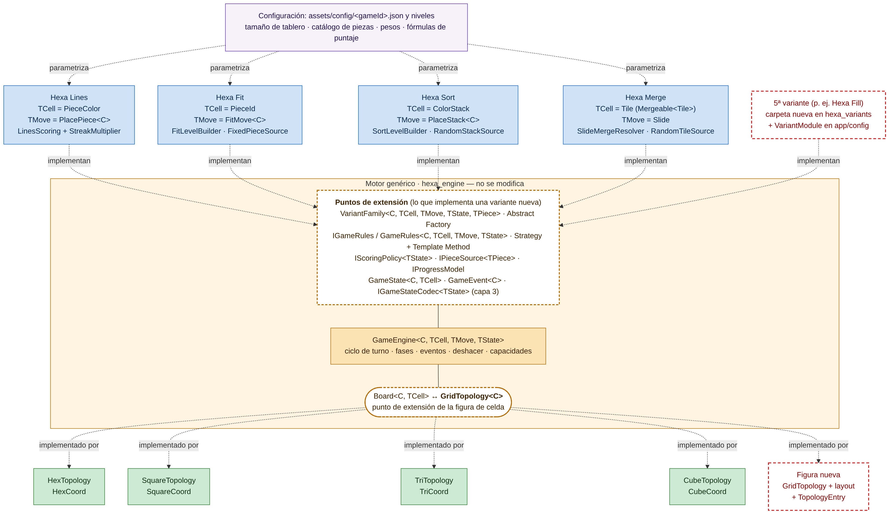

# EXTENSIBILITY — cómo se extiende HexaBlock Suite

> Exigido por el enunciado §3.1 y §4.3. Explica, paso a paso, **qué archivos se crean** y **cuáles no se tocan** para agregar una 5ª variante, otra figura de celda o un cambio de regla pequeño. La regla de oro: **el motor (`packages/hexa_engine`) no se modifica nunca**.
>
> Los nombres de clases y rutas son los previstos en `docs/architecture/ARQ-02-MOTOR.md` y `ARQ-03-APP-DETALLE.md`. Cuando exista el código, se revisan contra las clases reales (tarea de TEC-02).
>
> **Última actualización:** 2026-11-19

Fuente editable: `docs/diagrams/extensibilidad.mmd`.

---

## 1. Lo que nunca se modifica

| Paquete o archivo | Qué contiene | Por qué no hace falta tocarlo |
|---|---|---|
| `packages/hexa_engine/` | `GameEngine`, `Board`, `GridTopology`, `GameRules`, fases, eventos, `UndoHistory`, capacidades | Solo conoce abstracciones: no nombra ninguna variante ni figura, y el CI lo comprueba (RNF-02, RNF-04) |
| `packages/hexa_application/` | Casos de uso genéricos (`StartGameUseCase`, `ApplyMoveUseCase`, …), puertos y aspectos | Los casos de uso son genéricos en `C`, `TCell`, `TMove` y `TState` (RNF-07) |
| `packages/hexa_variants/lib/src/{lines,fit,sort,merge}/` | Las 4 variantes actuales | Cada variante es independiente |
| `packages/hexa_topologies/` | Hexágonos, cuadrados, triángulos y cubos | Una variante funciona con cualquier figura |
| `app/lib/adapters/game/game_cubit.dart` | `GameCubit<C, TCell, TMove, TState>` | Sirve para cualquier variante |
| Repositorios, gateways y Cubits de pantalla | Persistencia, red, navegación | No dependen de la variante |

## 2. Agregar una 5ª variante (ejemplo: Hexa Fill)

*Hexa Fill* es el ejemplo del enunciado: pintar celdas con restricciones. Las reglas concretas las definiría el equipo; aquí importa **dónde** va cada pieza.

### Paso 1 · Reglas de negocio

| Crear | Contenido |
|---|---|
| `docs/requirements/02-RN-HEXA-FILL.md` | Reglas con IDs nuevos y ejemplos `E-*` verificados con `tools/reference-sim/` |

### Paso 2 · Dominio (capa 1): una carpeta nueva en `hexa_variants`

| Crear en `packages/hexa_variants/lib/src/fill/` | Qué implementa | Punto de extensión |
|---|---|---|
| `fill_cell.dart` | `FillColor`: el contenido de una celda (`TCell`) | `TCell extends Object` |
| `fill_move.dart` | `sealed class FillMove<C>` con sus movimientos, p. ej. `PaintCell<C>` (`TMove`) | — |
| `fill_state.dart` | `FillState<C> implements GameState<C, FillColor>`; si hay azar, también `IRandomSeeded`; si hay niveles, `ILevelBased` | `GameState`, capacidades (D-33) |
| `fill_events.dart` | `sealed class FillEvent<C> extends GameEvent<C>` | `GameEvent` (D-32) |
| `fill_rejections.dart` (opcional) | `sealed class FillRejection extends RejectionReason`, solo si la pantalla debe explicar por qué se rechaza un movimiento; si no, las reglas devuelven `const InvalidMove()` | `RejectionReason` (D-95) |
| `hexa_fill_rules.dart` | `HexaFillRules<C> extends GameRules<C, FillColor, FillMove<C>, FillState<C>>`: `rejectionOf` (el motivo o `null` si es válido), `apply`, `validMoves` y, si hacen falta, los *hooks* `resolve`, `afterResolve` y `evaluate`. Nunca `playTurn` (D-36) | `GameRules` (Strategy + Template Method) |
| `fill_scoring.dart` | `FillScoring<C> implements IScoringPolicy<FillState<C>>` | `IScoringPolicy` |
| `fill_level_builder.dart` (si la variante es por niveles) | `FillLevelBuilder<C>`: arma y valida el nivel | Builder |
| `hexa_fill_factory.dart` | `HexaFillFactory<C> implements VariantFamily<C, FillColor, FillMove<C>, FillState<C>, TPiece>`: crea reglas, puntuación, fuente de piezas, el estado inicial (D-93) y la `GameSession`, con **solo** las capacidades que tenga (por ejemplo, `UndoHistory` sin límite) | `VariantFamily` (Abstract Factory) |

| Modificar | Cambio |
|---|---|
| `packages/hexa_variants/lib/hexa_variants.dart` | Una línea: `export 'src/fill/hexa_fill_factory.dart';` |

### Paso 3 · Configuración

| Crear | Contenido |
|---|---|
| `app/assets/config/hexa-fill.json` | Tamaño de tablero por figura, colores, fórmulas (RNF-11) |
| `app/assets/levels/hexa-fill/*.json` (si es por niveles) | Niveles en el esquema común, con la sección específica `hexa-fill` (RN-COM-70) |

### Paso 4 · Adaptadores (capa 3)

| Crear | Qué implementa |
|---|---|
| `app/lib/adapters/variants/fill/fill_state_codec.dart` | `FillStateCodec implements IGameStateCodec<FillState<C>>`, para la partida guardada (D-37) |
| `app/lib/adapters/variants/fill/fill_view_mapper.dart` | Convierte cada `FillEvent` en una animación de la pantalla |

### Paso 5 · Frameworks (capa 4)

| Crear | Qué implementa |
|---|---|
| `app/lib/frameworks/ui/painters/fill_cell_painter.dart` | Cómo se dibuja una `FillColor` dentro de una celda de **cualquier** figura (el layout lo pone la topología) |
| `app/lib/config/modules/hexa_fill_module.dart` | `HexaFillModule implements VariantModule`: en `open<C>()` crea `HexaFillFactory<C>`, envuelve los casos de uso con `AspectChain` y arma el `GameCubit` (ARQ-02 §3.1) |
| `app/lib/l10n/*.arb` | Textos de la variante en cada idioma (RNF-50) |

| Modificar | Cambio |
|---|---|
| `app/lib/config/variants.dart` | Una línea en el registro: `'hexa-fill': HexaFillModule()`. Es configuración del *composition root*: la pantalla de inicio lista las variantes del registro, así que aparece sola |

### Paso 6 · Backend

| Modificar | Cambio |
|---|---|
| Configuración de `gameId` permitidos en `hexablock-api` | Agregar `hexa-fill`, para que la validación de plausibilidad lo acepte (SEC-API-06). El progreso se guarda como JSON por variante, así que el esquema no cambia |

### Paso 7 · Pruebas

| Crear | Qué comprueba |
|---|---|
| `packages/hexa_variants/test/fill/hexa_fill_rules_test.dart` | Cada ejemplo `E-*` de `02-RN-HEXA-FILL.md` (RNF-22), con nombres `should_<resultado>_when_<condición>` |
| `packages/hexa_variants/test/fill/hexa_fill_determinism_test.dart` | Misma semilla y mismos movimientos → mismo estado (RNF-20) |
| `app/test/adapters/fill_state_codec_test.dart` | Guardar y leer devuelve el mismo estado |

### Comprobación final

Después de agregar la variante, `git diff --stat main` **no** debe mostrar cambios en `packages/hexa_engine/`, `packages/hexa_application/` ni en las carpetas de las otras 4 variantes. Las únicas líneas modificadas son las dos de registro (`hexa_variants.dart` y `variants.dart`) y la lista de `gameId` del backend.

## 3. Cambios de regla pequeños (lo que puede pedir el jurado)

| Pedido | Dónde se implementa | Qué se toca |
|---|---|---|
| **Otro tamaño de tablero** | `app/assets/config/<gameId>.json` → `GridTopology.cellsOf(ShapeSpec)` (Factory Method) | Solo configuración |
| **Otra política de puntuación** | Una clase nueva `…Scoring implements IScoringPolicy<TState>`, o un decorador como `BonusMultiplierDecorator<TState>` | La clase nueva y **una línea** en `createScoring()` de la fábrica de esa variante |
| **Una forma de pieza nueva** | El catálogo de piezas en la configuración (Lines) o la definición del nivel (Fit) | Solo configuración |
| **Una restricción de regla** (p. ej., límite de movimientos) | Un decorador de reglas: `MoveLimitRulesDecorator<…> implements IGameRules<…>`, que envuelve las reglas y agrega la condición en `evaluate` | La clase nueva y una línea en `createRules()` |
| **Otra ficha objetivo** (Merge) o **más metas** (Sort) | Configuración de la variante o del nivel | Solo configuración |

En ningún caso se modifica `GameEngine`, `Board` ni un caso de uso.

## 4. Agregar otra figura de celda

| Crear | Qué implementa |
|---|---|
| `packages/hexa_topologies/lib/src/<figura>/<figura>_coord.dart` | `final class XCoord extends Coord` (igualdad por valor) |
| `packages/hexa_topologies/lib/src/<figura>/<figura>_topology.dart` | `final class XTopology extends GridTopology<XCoord>` con constructor `const`. Declara sus ejes, direcciones y giros básicos, e implementa solo las primitivas de la figura: `cellsOf`, `neighbors` (en orden canónico), `step`, `lines`, `compareReadingOrder`, `rotateCell`, `normalizationOrigin` y `translate` (RN-COM-10 a 17). Normalizar, rotar, las orientaciones, los rayos, la colocación en un ancla (`place`, D-92) y el Visitor ya vienen escritos en `GridTopology` (D-90) |
| `packages/hexa_topologies/test/<figura>/<figura>_topology_test.dart` | Las pruebas del anexo y, en un `group`, `checkTopologyContract(XTopology(), <tablero por defecto>)` de `hexa_test_support`: la prueba de contrato común que toda topología debe pasar (igualdad por valor, vecinas, orden de lectura, líneas y direcciones, normalizar, orientaciones y colocar) |
| `docs/requirements/02-RN-TOPOLOGIAS.md` (anexo nuevo) | Reglas y ejemplos verificados de la figura |
| `app/lib/frameworks/ui/layouts/<figura>_layout.dart` | `XLayout implements TopologyLayout<XCoord>`: dónde se dibuja cada celda y qué celda se tocó |
| Catálogos y niveles por figura | Catálogos según D-20 (abierta); niveles según D-28: 3 de muestra de Fit por figura nueva; los de Sort con `any` ya sirven |

| Modificar | Cambio |
|---|---|
| `app/lib/config/topologies.dart` | Una línea en el registro: `'x': TopologyEntry(XTopology(), XLayout())`. El *Visitor* (D-29) recupera el tipo `XCoord`, sin `switch` |

Ninguna variante cambia: sus reglas usan las operaciones de `GridTopology`, así que funcionan con la figura nueva.
