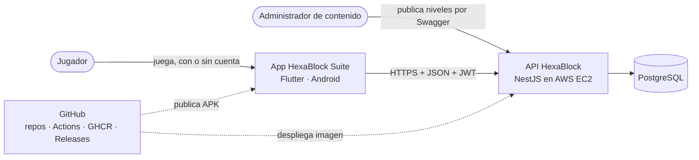
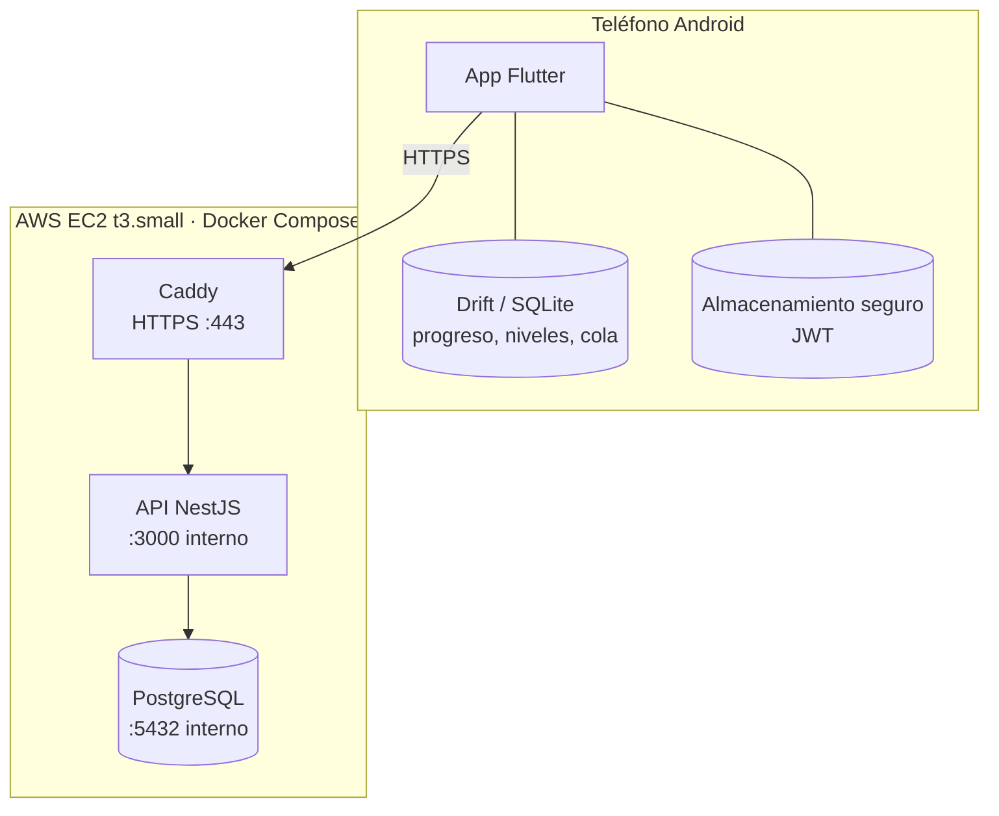
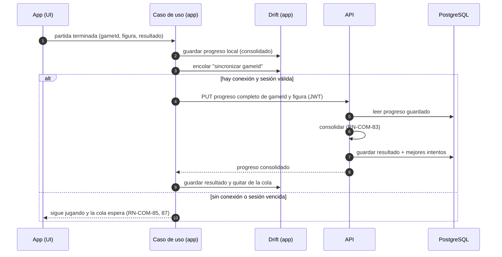
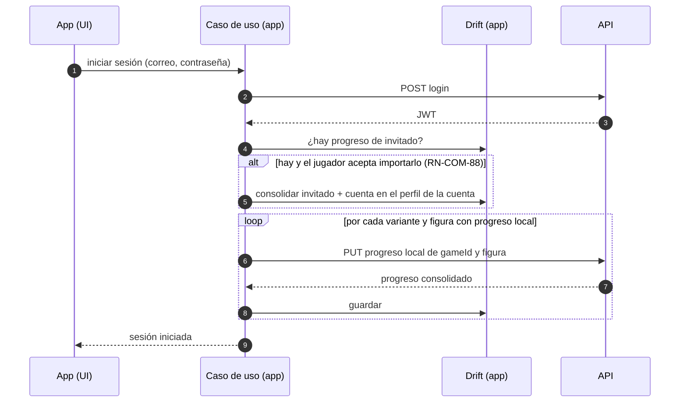
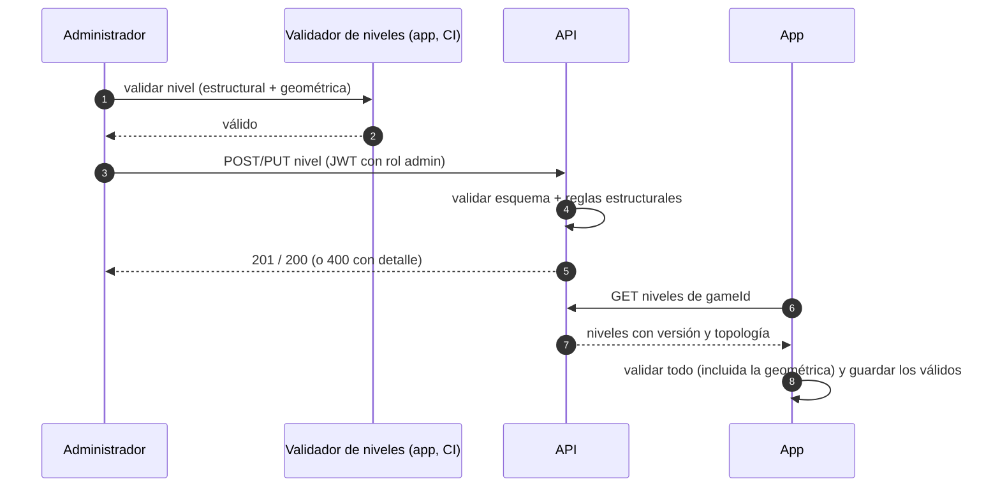

# ARQ-00 — Vista del sistema

| Campo | Valor |
|---|---|
| Estado | Borrador para revisión del equipo (Paso 2) |
| Fecha | 2026-11-11 (revisión de coherencia: 12-11) |
| Repositorio | **Compartido:** `docs/architecture/` en `hexablock-app` y `hexablock-api`; las dos copias deben ser idénticas |
| Relacionados | `ADR-001-tech-stack.md`, `ARQ-01-APP-GENERAL.md` (app), `ARQ-01-API-GENERAL.md` (API), `02-RN-CUENTA-PROGRESO-RANKING.md` |

**Qué cubre:** las piezas del sistema completo, qué hace cada una, cómo se comunican y quién es dueño de cada dato. La arquitectura interna de cada repo está en su `ARQ-01`.

---

## 1. Contexto

| Actor / sistema | Rol |
|---|---|
| **Jugador** | Usa la app. Puede jugar como **invitado** (sin cuenta) o con cuenta |
| **Administrador de contenido** | Publica y actualiza niveles con la API, desde Swagger (`/docs`) |
| **App** (`hexablock-app`) | Ejecuta las partidas, guarda el progreso en el dispositivo y sincroniza cuando puede |
| **API** (`hexablock-api`) | Cuentas, consolidación del progreso en el servidor, ranking y niveles publicados |
| **PostgreSQL** | Persistencia del servidor |
| **GitHub** | Código, CI, imágenes Docker (GHCR) y el APK en Releases |

## 2. Contenedores y despliegue

| Contenedor | Tecnología | Expuesto | Datos que guarda |
|---|---|---|---|
| App | Flutter + Dart 3 | — | Progreso por perfil, niveles descargados, cola de sincronización (Drift); ajustes (`shared_preferences`); JWT (almacenamiento seguro) |
| Proxy | Caddy | 80/443 | Certificados TLS |
| API | NestJS (Node LTS) | Solo a través de Caddy | — (sin estado: escala reiniciando el contenedor) |
| Base de datos | PostgreSQL | **No** | Usuarios, progreso consolidado, mejores intentos, niveles |

## 3. Quién es dueño de qué

| Dato o decisión | Dueño | Motivo |
|---|---|---|
| **Reglas de juego** (variantes, topologías, turnos) | **Solo la app** | El servidor no ejecuta partidas |
| **Progreso del jugador** | **El dispositivo primero** (offline-first); el servidor guarda la **versión consolidada** | El juego funciona sin conexión (RN-COM-82) |
| **Consolidación** del progreso | **Ambos**, con la misma regla y los mismos ejemplos de prueba | La app consolida al recibir la respuesta; el servidor, al recibir el progreso (RN-COM-83, 84) |
| **Ranking** | **Solo la API** | Necesita los datos de todos los jugadores |
| **Niveles publicados** | **La API** (fuente); la app guarda copias | La app trae niveles incluidos y descarga los nuevos (RN-COM-72) |
| **Validación de niveles** | API: estructural; app: estructural y **geométrica** | Validar que una pieza es una rotación de su forma requiere las topologías, que viven solo en la app (propuesta D-19) |
| **Identidad y sesión** | **La API** emite el JWT; la app lo guarda en almacenamiento seguro | SEC-API-02, SEC-MOB-01 |
| **Contrato** entre app y API | **`openapi.yaml`**, fuente única | Se define en el Paso 5 (D-23) |

## 4. Comunicación

| Aspecto | Decisión |
|---|---|
| Protocolo | REST sobre **HTTPS**, JSON |
| Versión | Prefijo `/api/v1` (SEC-API-09) |
| Autenticación | `Authorization: Bearer <JWT>` en los endpoints protegidos |
| Identidad | El usuario **siempre** sale del JWT, nunca de la URL ni del cuerpo (SEC-API-01) |
| Errores | Formato único `{ code, message, details }` (RF-91) |
| Variante y figura | `gameId` obligatorio en todo lo que es por variante; la **topología** (figura de celda) también, en progreso y ranking (D-25, propuesta D-27) |
| Reintentos | Solo desde la app, en la sincronización (la operación es repetible sin efectos: RN-COM-84) |
| Sin conexión | La app sigue funcionando; la cola se envía al recuperar la red |

## 5. Flujos que cruzan ambos repos

### 5.1 Sincronizar progreso (con cuenta)

### 5.2 Iniciar sesión con progreso de invitado

### 5.3 Publicar y recibir un nivel

## 6. Decisiones de esta vista

| ID | Decisión | Estado |
|---|---|---|
| ARQ-S-01 | Arquitectura **cliente–servidor offline-first**: el dispositivo es la fuente primaria del progreso; el servidor consolida y calcula el ranking | ✅ (P-08) |
| ARQ-S-02 | El servidor **no ejecuta reglas de juego**; solo valida la plausibilidad de los resultados (RN-COM-108) | 🟡 |
| ARQ-S-03 | La consolidación existe **dos veces** (Dart y TypeScript), con **ejemplos de prueba compartidos** (E-COM-2, E-COM-3) para garantizar que dan el mismo resultado | 🟡 |
| ARQ-S-04 | Sincronización por **snapshot completo por `gameId` y figura** (no por eventos) porque el progreso es chico y la consolidación es repetible. Cómo se guarda la figura en el servidor depende de D-27 | 🟡 |
| ARQ-S-05 | El contrato (`openapi.yaml`) y los ejemplos compartidos en formato JSON viven en `hexablock-api/docs/contracts/` y se copian a la app para sus pruebas de contrato | ⚠️ D-23 (Paso 5) |
