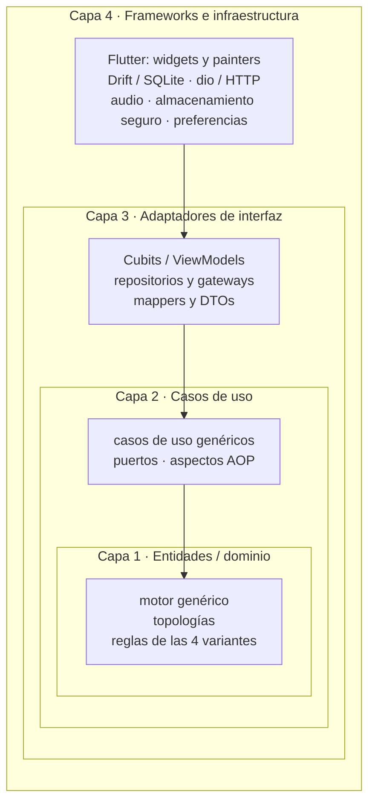
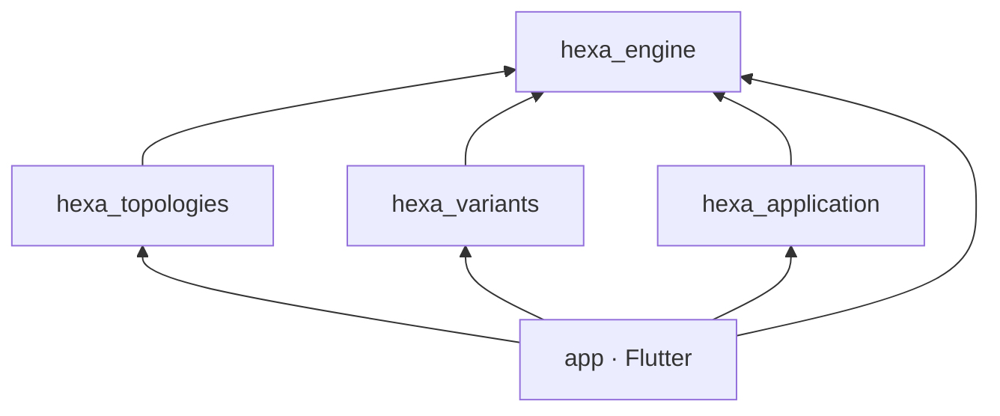
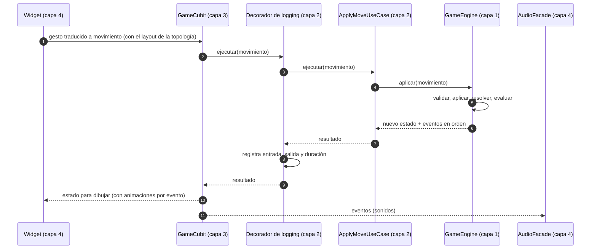

# ARQ-01 — Arquitectura general de la app

| Campo | Valor |
|---|---|
| Estado | Borrador para revisión del equipo (Paso 2) |
| Fecha | 2026-11-11 (revisión de coherencia: 12-11) |
| Repositorio | `hexablock-app` (`docs/architecture/ARQ-01-APP-GENERAL.md`) |
| Relacionados | `ARQ-00-SISTEMA.md` (compartido), `ADR-001-tech-stack.md`, `03-REQUISITOS.md` (RNF-01 a 11), `02-RN-TOPOLOGIAS.md` |

## 0. Alcance de este documento

**Decide:** las capas, los paquetes y su grafo de dependencias, qué componente vive en cada capa, los puertos principales, los flujos de alto nivel, dónde se configura cada variante y cada topología, y qué controla el CI.

**No decide** (se deja para los pasos siguientes):
- **Paso 3, motor genérico (lo decide el equipo):** firmas de los genéricos (`TCell`, `TMove`, `TState`), hasta qué capa llega `TCoord` (la coordenada como parámetro genérico ya está decidida: D-07, ARQ-A-09), máquina de estados, modelo de eventos, cómo se implementa deshacer.
- **Paso 4, arquitectura detallada:** firmas de los casos de uso, mapa de patrones (patrón → clase → por qué), aspectos AOP concretos, diagramas oficiales y `EXTENSIBILITY.md`. Hecho en `ARQ-03-APP-DETALLE.md`, `docs/diagrams/` y `docs/EXTENSIBILITY.md` (D-38 a D-43).

**Estados:** ✅ ya decidido (ADR-001 o enunciado) · 🟡 propuesta para que el equipo confirme.

---

## 1. Qué tiene que cumplir esta arquitectura

| Requisito | Qué le exige a la arquitectura |
|---|---|
| RNF-01, 02 (un solo motor genérico, sin condicionales por variante) | El motor no puede **ver** ninguna variante: ni importarla ni nombrarla |
| RNF-03 (5ª variante sin tocar el motor) | Agregar una variante = código nuevo + registro en configuración |
| RNF-04 (topología intercambiable, hasta cubos) | El motor y las reglas dependen de la **abstracción** de topología; su dibujo es otra pieza, en presentación |
| RNF-06 (Clean: el dominio no depende de nada externo) | Dominio sin Flutter, sin base de datos y sin red. Se prueba con `dart test` |
| RNF-07 (casos de uso genéricos) | Los casos de uso no pueden **ver** las variantes |
| RNF-10 (AOP sin librerías) | Los casos de uso tienen una interfaz común que se puede decorar |
| RNF-20 (determinismo) | El azar y el reloj entran por puertos inyectables |
| RNF-34 (offline) | Todo el juego funciona con adaptadores locales; la red es opcional |

## 2. Las cuatro capas



Las dependencias apuntan **siempre hacia adentro**: la capa 4 conoce a la 3, la 3 a la 2, la 2 a la 1. Nunca al revés.

| Capa | Qué contiene | Qué **no** puede contener |
|---|---|---|
| **1. Entidades** | Motor genérico (tablero, ciclo de turno, estados, historial, eventos de dominio); abstracciones de topología, fuente de piezas, puntuación, progreso y azar (xorshift32); topologías concretas (hexágonos, cuadrados, triángulos, cubos); reglas, puntuación, fuentes y criterios de mejor intento de las 4 variantes; validadores de niveles; consolidación del progreso | Flutter, Drift, dio, `dart:io`, reloj del sistema, cualquier paquete de terceros |
| **2. Casos de uso** | Casos de uso **genéricos** (iniciar partida, aplicar movimiento, deshacer, rehacer, pausar, guardar progreso, sincronizar, cargar niveles, iniciar y cerrar sesión, importar progreso de invitado, consultar ranking); **puertos** (interfaces) que necesitan; **aspectos** como decoradores que solo dependen de puertos | Implementaciones concretas, Flutter, cualquier nombre de variante |
| **3. Adaptadores** | Cubits (uno por tipo de pantalla, genéricos sobre la variante); gateways; mappers dominio ↔ DTO y la serialización del estado de cada variante | Widgets, consultas SQL, detalles HTTP, imports de `app/lib/frameworks/` |
| **4. Frameworks** | Widgets, `CustomPainter` por topología y por contenido de celda, base de datos Drift, cliente dio, audio, almacenamiento seguro, preferencias, i18n (ARB), `main.dart` y el *composition root*; los **repositorios que se apoyan en un framework** (Drift, almacenamiento seguro, preferencias), que implementan directamente los puertos de la capa 2 (D-156) | Reglas de juego |

## 3. Paquetes del repositorio (pub workspace)

La regla de dependencia no se deja a la disciplina: **la hace cumplir el gestor de paquetes**. Un paquete solo puede importar lo que declara en su `pubspec.yaml`.

```
hexablock-app/
├── pubspec.yaml                 # workspace: lista los paquetes (un solo pubspec.lock)
├── analysis_options.yaml        # análisis estricto; cada paquete lo incluye
├── packages/
│   ├── hexa_engine/             # Capa 1 · motor genérico y abstracciones
│   ├── hexa_topologies/         # Capa 1 · hexágonos, cuadrados, triángulos, cubos
│   ├── hexa_variants/           # Capa 1 · Lines, Fit, Sort, Merge (una carpeta por variante)
│   ├── hexa_application/        # Capa 2 · casos de uso, puertos, aspectos
│   └── hexa_test_support/       # Solo pruebas · fakes y stubs compartidos (D-56)
├── app/                         # Capas 3 y 4 · aplicación Flutter
│   ├── lib/
│   │   ├── adapters/            # Capa 3
│   │   │   ├── presentation/    #   cubits por tipo de pantalla
│   │   │   ├── repositories/    #   repositorios en memoria que todavía no tienen framework
│   │   │   ├── gateways/        #   implementaciones de los puertos remotos
│   │   │   └── mappers/         #   DTO ↔ dominio, serialización por variante
│   │   ├── frameworks/          # Capa 4
│   │   │   ├── ui/              #   pantallas, widgets, painters (topología × contenido)
│   │   │   ├── persistence/     #   Drift (tablas, migraciones) y sus repositorios (D-156)
│   │   │   ├── network/         #   dio, interceptores
│   │   │   └── platform/        #   audio, almacenamiento seguro, preferencias y sus repositorios, logger
│   │   ├── config/              #   registro de variantes y topologías
│   │   └── main.dart            #   composition root (get_it)
│   ├── android/                 #   proyecto Android generado por flutter create
│   ├── assets/                  #   niveles incluidos, configuración por variante, audio, l10n
│   └── test/                    #   pruebas de widget, de navegación y de integración
├── tools/                       # scripts de CI (verificación de arquitectura, validador de niveles)
└── docs/
```

### 3.1 Grafo de dependencias permitido



| Paquete | Puede depender de | **No** puede depender de | Por qué |
|---|---|---|---|
| `hexa_engine` | Nada (solo el SDK de Dart) | Ningún otro paquete | Es el centro: si el motor no ve las variantes, no puede tener condicionales sobre ellas (RNF-02) |
| `hexa_topologies` | `hexa_engine` | `hexa_variants`, `hexa_application` | Una topología no sabe a qué se juega encima. Agregar una figura nueva es agregar clases aquí; el motor no cambia |
| `hexa_variants` | `hexa_engine` | `hexa_topologies` (solo en pruebas), `hexa_application` | Las reglas usan la **abstracción** de topología (RN-COM-10); así funcionan con cualquiera |
| `hexa_application` | `hexa_engine` | `hexa_variants`, `hexa_topologies` | Si la capa de casos de uso no ve las variantes, no puede haber un caso de uso por juego (RNF-07) |
| `app` | Todos | — | Es la capa externa; el composition root conecta todo |

Los cuatro paquetes de dominio y aplicación no tienen dependencias de terceros (solo `test` como dependencia de desarrollo).

`hexa_test_support` depende de `hexa_engine` y `hexa_application` y solo aparece como `dev_dependency` de los demás. Su único fin es que los dobles de prueba se escriban una vez (D-56).

### 3.2 Qué hay que tocar para extender

| Cambio | Archivos nuevos | Archivos que se modifican | Motor |
|---|---|---|---|
| **5ª variante** | Carpeta en `hexa_variants/`; su mapper en `app/adapters/mappers/`; su painter de contenido de celda en `app/frameworks/ui/`; su configuración en `assets/` | Solo el **registro** en `app/lib/config/` | **Sin cambios** |
| **Nueva topología** | Clase en `hexa_topologies/`; su layout en `app/frameworks/ui/`; su anexo en `02-RN-TOPOLOGIAS.md`; su catálogo de piezas | Solo el **registro** en `app/lib/config/` | **Sin cambios** |
| **Cambio de regla** (por ejemplo, otro puntaje) | Una nueva estrategia de puntuación, o un cambio de configuración | La configuración de la variante | **Sin cambios** |

El paso a paso completo, con las clases y rutas previstas, está en `docs/EXTENSIBILITY.md`.

## 4. Componentes por capa

### 4.1 Capa 1 — dominio

| Componente | Paquete | Responsabilidad |
|---|---|---|
| Motor genérico | `hexa_engine` | Ciclo de turno validar → aplicar → resolver → evaluar → notificar (RN-COM-20); estados de la partida; historial para deshacer y rehacer; eventos de dominio |
| Abstracción de topología | `hexa_engine` | `Coord` y `GridTopology<TCoord extends Coord>` (D-07, opción A): Las operaciones de RN-COM-10: celdas, vecinas ordenadas, ejes, líneas, direcciones, rayos, giros, normalización |
| Abstracciones de variante | `hexa_engine` | Reglas, fuente de piezas, puntuación, modelo de progreso y **fábrica de variante** (Abstract Factory, obligatorio) |
| Azar | `hexa_engine` | Puerto de azar con semilla e implementación xorshift32 (RN-COM-40 a 45) |
| Progreso | `hexa_engine` | Modelo de progreso genérico y **consolidación** (RN-COM-83), parametrizada por el criterio de mejor intento de cada variante |
| Topologías concretas | `hexa_topologies` | Anexos A a D de `02-RN-TOPOLOGIAS.md`: por cada figura, su coordenada y su topología (`HexCoord` + `HexTopology`, `SquareCoord`, `TriCoord`, `CubeCoord`…). Aquí vive también **`HexBoard<TCell>`**, el nombre que usa el enunciado para el tablero hexagonal: **no** puede vivir en `hexa_engine`, porque usa la topología hexagonal |
| Variantes | `hexa_variants` | Por variante: reglas, puntuación, fuente de piezas, criterio de mejor intento, validador de niveles (estructural y geométrico) y su fábrica |

### 4.2 Capa 2 — casos de uso y puertos

**Casos de uso genéricos** (los nombres siguen el enunciado §3.4; las firmas están en `ARQ-03-APP-DETALLE.md` §3):

| Caso de uso | Qué hace | Puertos que usa |
|---|---|---|
| `StartGameUseCase` | Crea una partida de cualquier variante a partir de su configuración (y nivel, si aplica) | Registro de variantes, `ILevelRepository`, semilla |
| `ApplyMoveUseCase` | Aplica un movimiento con el motor | — |
| `UndoMoveUseCase` / `RedoMoveUseCase` | Deshace o rehace, si la variante lo permite | — |
| `PauseGameUseCase` / `ResumeGameUseCase` | Pausa y reanuda; al pausar, guarda la partida (RN-COM-33) | `ISavedGameRepository` |
| `SaveProgressUseCase` | Guarda el resultado en el perfil activo y lo marca como pendiente de enviar | `IProgressRepository`, `ISyncOutbox` |
| `SyncProgressUseCase` | Envía los resultados pendientes y consolida las respuestas (D-49) | `IProgressGateway`, `IProgressRepository`, `ISyncOutbox`, `ISessionStore` |
| `LoadLevelsUseCase` | Junta los niveles incluidos y los descargados, valida y ordena | `ILevelRepository`, `ILevelGateway` |
| `RegisterUseCase` / `LoginUseCase` / `LogoutUseCase` | Cuenta y sesión | `IAuthGateway`, `ISessionStore`, `IProfileRepository` |
| `ImportGuestProgressUseCase` | Consolida el progreso de invitado en la cuenta | `IProgressRepository`, `IProfileRepository` |
| `GetLeaderboardUseCase` | Consulta el ranking | `ILeaderboardGateway` |
| `SyncLeaderboardUseCase` | (nombre del enunciado) Envía resultados que cuentan para el ranking; puede unificarse con `SyncProgressUseCase` | `IProgressGateway` |

**Puertos** (interfaces definidas en `hexa_application`):

| Puerto | Responsabilidad | Implementación (capa 4 si se apoya en un framework, D-156) |
|---|---|---|
| `IProgressRepository` | Progreso por perfil, `gameId` y figura (D-27) | Repositorio → Drift |
| `IProfileRepository` | Perfil activo (invitado o cuenta) | Repositorio → Drift + preferencias |
| `IUnitOfWork` | Leer, consolidar y escribir como una sola transacción (D-158) | Transacción de Drift |
| `ILevelRepository` | Niveles incluidos y descargados | Repositorio → assets + Drift |
| `ISyncOutbox` | Resultados pendientes de enviar (una marca en cada fila, D-49) | Repositorio → Drift |
| `ISavedGameRepository` | Partida en curso guardada por perfil, variante y figura (D-37) | Repositorio → Drift |
| `IProgressGateway` | Enviar y recibir el progreso del servidor | Gateway → dio |
| `ILevelGateway` | Descargar niveles | Gateway → dio |
| `ILeaderboardGateway` | Consultar el ranking | Gateway → dio (+ caché) |
| `IAuthGateway` | Registro e inicio de sesión | Gateway → dio |
| `ISessionStore` | Guardar y borrar el JWT | Almacenamiento seguro |
| `ISettingsRepository` | Idioma, audio y figura de las celdas (D-25) | Preferencias |
| `IClock` | Hora actual y tiempo activo | Reloj del sistema (en pruebas: reloj falso) |
| `IConnectivity` | Saber si hay red | Plugin de conectividad |
| `ILogger` | Registro estructurado (lo usan los aspectos, no los casos de uso) | Logger de plataforma |

**Aspectos** (decoradores en `hexa_application/aspects/`): envuelven cualquier caso de uso y solo dependen de puertos (`ILogger`, `IClock`, `ISessionStore`). Como envuelven el caso de uso **genérico**, aplican a las 4 variantes sin cambios (§3.5 del enunciado). Elegidos (D-40, D-41): registro, métricas, errores con reintentos y sesión, en ese orden de adentro hacia afuera; detalle en `ARQ-03-APP-DETALLE.md` §5.

### 4.3 Capa 3 — adaptadores

| Componente | Responsabilidad |
|---|---|
| **Cubits** por tipo de pantalla | `GameCubit` (genérico: sirve para las 4 variantes), `LevelSelectCubit`, `HomeCubit`, `SettingsCubit`, `AccountCubit`, `LeaderboardCubit`. Escuchan los eventos de dominio y exponen un estado listo para dibujar |
| **Gateways** | Implementan los puertos remotos sobre dio; traducen errores HTTP a errores de aplicación |
| **Mappers** | Dominio ↔ DTO de la API; **serialización del estado de cada variante** (para pausar y guardar). El paso entre el dominio y las filas de Drift lo hace cada repositorio, en la capa 4 (D-156) |

### 4.4 Capa 4 — frameworks

| Componente | Responsabilidad |
|---|---|
| **UI** | Pantallas y widgets. El tablero se dibuja combinando dos estrategias: el **layout de la topología** (dónde está cada celda y en qué celda cayó el toque) y el **pintor del contenido** de cada variante (color, pila, número, pieza) |
| **Audio** | Fachada (`AudioFacade`) que reacciona a los eventos de dominio: no hay audio en los casos de uso |
| **Persistencia** | Drift: tablas `profiles`, `level_results`, `records`, `downloaded_levels`, `level_sync_cursors` y `saved_games` (D-37, D-48, D-49; columnas en `ARQ-04-APP-DATOS.md`), y los repositorios que implementan sobre ellas los puertos de la capa 2: `DriftProfileRepository`, `DriftProgressRepository`, `DriftUnitOfWork` y después `DriftSavedGameRepository`, `DriftSyncOutbox` y `LevelRepository` (D-156, D-158) |
| **Red** | dio con interceptores: token JWT, tiempo de espera, traducción de errores |
| **Plataforma** | `flutter_secure_storage`, `shared_preferences`, conectividad, logger, y los repositorios sobre ellos (`SecureSessionStore`, el de preferencias) y `SystemClock` (D-156) |
| **Composition root** | `main.dart` + `get_it`: crea las implementaciones, aplica los decoradores y registra variantes y topologías |

## 5. Configuración: variantes y topologías

| Qué | Dónde | Ejemplo |
|---|---|---|
| Qué variantes existen | Registro en `app/lib/config/` | `hexa-lines` → fábrica de Hexa Lines (dominio) + mapper + pintor de contenido (presentación) |
| Qué topologías existen | Registro en `app/lib/config/` | `hex` → topología hexagonal + layout hexagonal |
| Parámetros de cada variante | `assets/config/<gameId>.json` | por topología: forma del tablero y catálogo; además pesos, fórmula de puntaje, ficha objetivo |
| Niveles incluidos | `assets/levels/<gameId>/*.json` | Validados en CI con el validador de niveles |

**Figura elegida por el jugador (D-25):** `StartGameUseCase` lee la figura de `ISettingsRepository`, el *composition root* la despacha con la función genérica de ARQ-A-09 y la partida queda creada con su `TCoord`. Mientras exista una partida en curso o en pausa, `SettingsCubit` bloquea la opción (RN-TOP-31). Las figuras que aparecen en Ajustes son las registradas en `app/lib/config/` (RN-TOP-30).

## 6. Flujos principales

### 6.1 Un movimiento



### 6.2 Fin de partida y progreso

Fin de partida → `SaveProgressUseCase` consolida el resultado en el perfil activo (Drift) y lo marca como pendiente → si hay conexión y sesión, `SyncProgressUseCase` envía los resultados pendientes y guarda lo consolidado (D-49) (ver `ARQ-00-SISTEMA.md` §5.1).

### 6.3 Arranque

`main.dart` → crea la base de datos y los adaptadores → registra variantes y topologías → envuelve los casos de uso con los aspectos → lee el perfil activo → muestra el inicio → en segundo plano, si hay conexión, envía la cola y busca niveles nuevos.

## 7. Errores

| Tipo | Dónde nace | Cómo se maneja |
|---|---|---|
| **Movimiento inválido** | Dominio | No es un error: el motor devuelve "inválido" y el estado no cambia (RN-COM-21) |
| **Nivel inválido** | Dominio (validador) | Se descarta el nivel y se registra |
| **Error de red o de servidor** | Gateway (capa 3) | Se traduce a un error de aplicación (sin conexión, sesión vencida, conflicto, validación); el juego sigue |
| **Error de persistencia** | Repositorio (capa 3) | Se traduce a un error de aplicación; las escrituras son transaccionales (RNF-35) |
| **Error inesperado** | Cualquier capa | Lo captura un aspecto o el cubit; nunca se muestra un stack al jugador |

El dominio **no lanza excepciones de infraestructura** porque no la conoce. Los adaptadores lanzan excepciones tipadas, los casos de uso devuelven un `Either` con el fallo o el resultado, y hacia la pantalla siempre llega un `Either` (D-39, D-160, D-161, `ARQ-03-APP-DETALLE.md` §2).

## 8. Controles automáticos en CI

| Control | Cómo | Requisito |
|---|---|---|
| El dominio no importa Flutter ni paquetes externos | Los `pubspec.yaml` de los paquetes de dominio no los declaran: no compila | RNF-06 |
| El motor no ve las variantes | `hexa_engine` no depende de `hexa_variants`; además, un script falla si el código del motor (fuera de comentarios) contiene un **identificador** de variante: `HexaLines`, `HexaFit`, `HexaSort`, `HexaMerge`, `hexa_variants` o los `gameId` (`hexa-lines`…) | RNF-02 |
| El motor no ve las figuras | `hexa_engine` no depende de `hexa_topologies`; además, el mismo script falla si aparece un identificador de figura: `HexCoord`, `HexTopology`, `SquareCoord`, `TriCoord`, `CubeCoord`, `HexBoard` o `hexa_topologies` | RNF-04 |

> Se buscan **identificadores completos** y no palabras sueltas: buscar `sort`, `tri` o `hex` daría falsos positivos con `List.sort()`, `String` o el propio nombre `hexa_engine`.
| Los casos de uso no ven las variantes | `hexa_application` no depende de `hexa_variants` | RNF-07 |
| Ningún caso de uso llama al logger | Script que busca usos de `ILogger` fuera de `aspects/` | RNF-10 |
| Los adaptadores no ven la capa 4 | El mismo script falla si un archivo de `app/lib/adapters/` importa algo de `frameworks/` o `package:drift` | D-156 |
| El código generado está al día | El job `flutter` corre `build_runner` en `app/` y falla si algún `*.g.dart` cambia o aparece sin subir (#149) | ARQ-04 §6 |
| Niveles incluidos válidos | Validador de niveles sobre `assets/levels/` | RF-83 |
| Paridad de idiomas | Script que compara las claves de los ARB | RNF-50 |

## 9. Decisiones de este documento

Las decisiones están en `docs/DECISIONES.md` (D-67). Los IDs propios de este documento se conservan:

| ID | Dónde está ahora |
|---|---|
| ARQ-A-01 | `DECISIONES.md` (cuatro capas) |
| ARQ-A-02 | D-21 |
| ARQ-A-03 | D-21 |
| ARQ-A-04 | D-21 |
| ARQ-A-05 | `DECISIONES.md` (Paso 4) |
| ARQ-A-06 | `DECISIONES.md` (Paso 4) |
| ARQ-A-07 | `DECISIONES.md` (Paso 4) |
| ARQ-A-08 | `DECISIONES.md` (Paso 4) |
| ARQ-A-09 | D-07 |

Las preguntas del Paso 3 que estaban aquí se respondieron en `ARQ-02-MOTOR.md` (D-29 a D-36).
