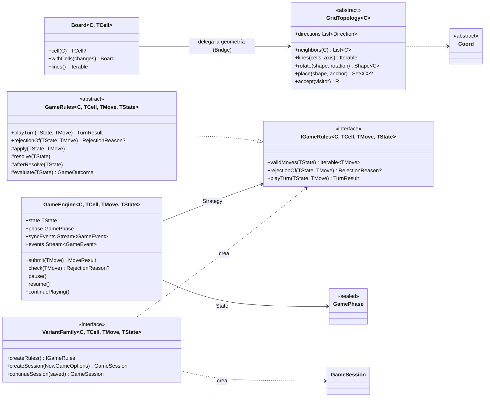
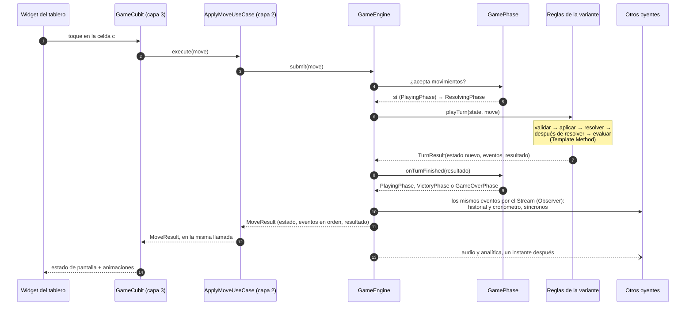

# ARQ-02 — Motor genérico (Paso 3)

| Campo | Valor |
|---|---|
| Estado | **Decidido (17-11-2026)**: el equipo adoptó todas las recomendaciones, con la mejora de D-32 (D-29 a D-35 en `docs/DECISIONES.md`). D-36 decidida el 20-11 (§9.6); D-93 a D-96, el 21-11 en el *spike* del ciclo de turno (§2, §6, §9.2, §9.6); D-97 a D-101, el mismo día, en las estrategias (§9.7); D-102 a D-107 y D-109, el 22-11, en deshacer, el cronómetro y la sesión (§5 a §8); D-111, D-113 y D-116, el mismo día, en cómo se guarda y continúa una partida (§7, §8, §9.7); D-124, el 23-11, en dónde vive `VariantFamily` y qué recibe una partida nueva (§9.1) |
| Fecha | 2026-11-17 (revisión: D-32 con retorno síncrono a la pantalla; decidido el mismo día) |
| Repositorio | `hexablock-app` (`docs/architecture/ARQ-02-MOTOR.md`) |
| Parte de | Responde las 6 preguntas del Paso 3 que dejó `ARQ-01-APP-GENERAL.md` |
| Fija | Tipos genéricos, contratos del motor, ciclo de turno, fases de la partida, eventos, deshacer, capacidades opcionales y **patrones de diseño del dominio** |
| No fija | Firmas de los casos de uso y puertos (Paso 4), formato de los niveles (`docs/contracts/`, Paso 5) y del estado guardado (lo define el codec de cada variante, `ARQ-04-APP-DATOS.md` §8) |

**Cómo leer este documento.** Empieza con el diseño final en una página. Las secciones 3 a 8 explican cada decisión con un esbozo de código; las opciones que se compararon, con sus ventajas y desventajas, están en el Anexo A como registro de lo que se descartó y por qué, útil para la defensa (D-68).

> **Los esbozos de código no están compilados.** En esta planificación no hay SDK de Dart disponible. Están escritos para Dart 3 (*sealed*, *records*, *extension types*, genéricos reificados) y se validan en el *spike* de TEC-01 antes de escribir las variantes. El código va en inglés.
>
> **Avance del *spike* (21-11):** el tablero, la topología, `Shape` y el Visitor (§3.1, §4.3 `Coord`) ya compilan y tienen pruebas en `packages/hexa_engine/lib/src/board/`. La forma del tablero es `ShapeSpec` (D-90) y una coordenada fuera del tablero lanza un error (D-91). Una diferencia con el esbozo: Dart no obliga a una subclase de `Coord` a implementar `==` y `hashCode` (una redeclaración abstracta hereda igual la de `Object`), así que lo comprueban las pruebas de cada topología. El ciclo de turno también compila y tiene pruebas en `packages/hexa_engine/lib/src/game/` (reglas, motor, fases y eventos). El estado inicial lo crea la fábrica (D-93), el orden de los eventos del motor quedó fijado (D-94) y el motivo de un rechazo es una jerarquía abierta (D-95). Una diferencia con el esbozo de §8: `onTurnStarted` y `onTurnFinished` están en la base `GamePhase`, así el motor delega en la fase sin preguntar cuál es. El generador (`Xorshift32`, E-COM-1), el reloj (`IMonotonicClock`) y las tres estrategias (`IPieceSource`, `IScoringPolicy` e `IProgressModel`, D-97 a D-99, §9.7) están en `packages/hexa_engine/lib/src/random/`, `time/` y `strategy/`. Deshacer (`MoveCommand`, `UndoHistory`, `GameEngine.restore` y `committedTurns`), las capacidades, el cronómetro (`ActiveTimer`) y la sesión (`GameSession`) están en `packages/hexa_engine/lib/src/undo/`, `session/` y `time/` (D-102 a D-107 y D-109). Una diferencia con el esbozo de §7: `ActiveTimer` recibe del motor solo lo que necesita (`TimedEngine`: la fase y `syncEvents`), igual que `UndoHistory` con `UndoableEngine`. La interfaz `VariantFamily` y `NewGameOptions` (D-124) están en `session/`.

---

## Diseño final en una página

Lo que decidió el equipo (D-07, D-29 a D-36). Las secciones 3 a 9 tienen el detalle y el código; las opciones que se descartaron están en el Anexo A (D-68).

| Tema | Diseño | § | Decisión |
|---|---|---|---|
| Coordenada | Parámetro genérico: `Board<TCoord extends Coord, TCell>`, `GridTopology<TCoord>`, `IGameRules<TCoord, TCell, TMove, TState>` y `GameEngine<…>`; `HexBoard<TCell>` es un `typedef` | §3 | D-07 |
| Figura de la celda | Registro de topologías + **Visitor** genérico, sin `switch` ni casts; `TCoord` llega hasta el widget del tablero | §3 | D-29 |
| Tipos por variante | Estado inmutable; celda vacía = `null` (`TCell extends Object`); movimientos *sealed* por variante; `Tile implements Mergeable<Tile>` en Merge | §4 | D-30 |
| Deshacer y rehacer | **Command + Memento** con un `UndoHistory` genérico que configura la fábrica (Fit: sin límite y con rehacer; Merge: 1; Lines y Sort: nada). `restore` mantiene la fase, exige que permita deshacer y publica `StateRestored` y, si cambió, `ScoreChanged`. La partida guardada lleva el historial como la línea de estados alrededor del actual (`UndoSnapshot`); un contador que deshacer no debe cambiar lo conserva el `carryOver` de la variante | §5 | D-31, D-102, D-103, D-107, D-109 |
| Eventos | Las reglas devuelven los eventos en orden; la pantalla los recibe en el `MoveResult` de `submit`; el `Stream` del motor queda para el historial, el cronómetro, el audio y la analítica. Orden fijo: fase → reglas → puntaje → fase; un rechazo publica solo `MoveRejected` | §6 | D-32, D-94 |
| Estado inicial | Lo crea la fábrica (o lo lee el codec al continuar) y se lo pasa a `GameEngine`; `IGameRules` no tiene `initialState` | §2 | D-93 |
| Motivo de un rechazo | Jerarquía abierta `RejectionReason` (`InvalidMove`, `NotAcceptingMoves` y los de cada variante); las reglas validan con `rejectionOf` | §6, §9.6 | D-95 |
| Vista previa | `IGameRules.rejectionOf` es público y `GameEngine.check(move)` da el motivo que daría `submit` (la fase o las reglas) sin jugar el movimiento ni publicar nada; la pantalla lo pide mientras se arrastra una pieza | §9.6 | D-138 |
| Capacidades opcionales | Interfaces segregadas (`IUndoable`, `ITimed`, `IRandomSeeded`, `ILevelBased`) que la fábrica compone en una `GameSession`; `IMonotonicClock` en el dominio. `ILevelBased.levelId`; `ITimed.activeTime` es un `Duration`; `ActiveTimer` calcula el tiempo al leerlo, la fase dice si corre y deshacer no lo retrocede. `GameSession.snapshot()` da el estado, el historial y el tiempo que guarda la partida | §7 | D-33, D-104 a D-106, D-113 |
| Fases | Patrón **State** con 5 fases *sealed*; `Victory(canContinue)` para Merge. Una partida guardada vuelve con `GameEngine.paused` | §8 | D-34, D-111 |
| Patrones del dominio | 14: Abstract Factory, Builder, Factory Method; Bridge, Composite, Decorator; Strategy, Template Method, State, Observer, Command, Memento, Iterator, Visitor | §9 | D-35 |
| Template Method protegido | Regla en la plantilla de PR + prueba de arquitectura en CI que falla si una variante declara `playTurn` | §9.6 | D-36 |
| Decoradores de reglas | Extienden `GameRules` y delegan cada paso en las reglas que envuelven; nunca declaran `playTurn` | §9.2, §9.6 | D-96 |
| Estrategias de la variante | `IPieceSource` recibe el generador del estado y devuelve el siguiente; `IScoringPolicy` puntúa cada paso con sus eventos; `IProgressModel` es el criterio del mejor intento; la fábrica las crea y las conecta en sus reglas, y `VariantFamily` solo expone `createRules`, `createSession` y `continueSession` (continuar una partida guardada) | §9.7 | D-97 a D-101, D-116 |

## 1. Qué tiene que cumplir el motor

| Exigencia | Fuente |
|---|---|
| Un solo tablero y un solo motor, genéricos en contenido de celda, movimiento y estado; las 4 variantes son instanciaciones, no copias | Enunciado §3.1, RNF-01 |
| La figura de la celda también es genérica: `Board<TCoord, TCell>` (hexágonos, cuadrados, triángulos, cubos) | D-07, D-18, D-25, RNF-04 |
| El motor no tiene condicionales por variante ni por figura | Enunciado §3.2 (LSP), RNF-02 |
| Ciclo fijo: validar → aplicar → resolver → evaluar → notificar; cada paso visible se notifica en orden | RN-COM-20 a 25 |
| Fases: en juego, resolviendo, en pausa, victoria, derrota; Merge sigue tras la victoria | RN-COM-30, 31; RN-HM-51 |
| Determinismo con semilla; el generador es parte del estado y se restaura al deshacer | RN-COM-40 a 45 |
| Deshacer: Lines no, Fit ilimitado + rehacer, Sort no, Merge 1 | RN-COM-60 a 63 |
| Tiempo activo en Fit (sin pausas) | RN-COM-52, RN-HF-52 |
| Restricciones de tipo justificadas (p. ej., `TCell: IMergeable<TCell>`) | Enunciado §3.1, RNF-05 |
| Strategy y Abstract Factory obligatorios; además, al menos 2 patrones por categoría | Enunciado §3.3, RNF-09 |
| El dominio no depende de nada externo y se prueba con un tipo de celda de prueba | Enunciado §3.4, §3.6; RNF-06 |
| Un cambio de regla en la defensa queda confinado a clases nuevas o a configuración | Enunciado §3.1 |

## 2. Vista general (con las recomendaciones aplicadas)





---

## 3. Despacho de la figura y alcance de `TCoord` (D-29)

La figura la elige el jugador en Ajustes (D-25), así que se conoce **en tiempo de ejecución**, pero el tipo `TCoord` tiene que existir **en compilación** para que el tablero sea seguro (D-07). Hace falta un punto que convierta "el id `hex` que leí de Ajustes" en "`GameEngine<HexCoord, …>`", sin casts y sin condicionales fuera del *composition root*.

### 3.1 Cómo se despacha

Opciones consideradas: Anexo A.3.1.

**Elegida: A.** El registro no pierde nada: una `GridTopology<HexCoord>` se guarda como `GridTopology<Coord>` (los genéricos de Dart son covariantes) y `accept` recupera el tipo real.

```dart
// hexa_engine
abstract interface class TopologyVisitor<R> {
  R visit<C extends Coord>(GridTopology<C> topology);
}

abstract base class GridTopology<C extends Coord> {
  String get id; // 'hex', 'square', 'tri', 'cube'
  // ... geometry operations (RN-COM-10) ...

  /// The cells of [shape] with its first cell in reading order on [anchor],
  /// or null if [anchor] is of another cell type (D-92). Written once here.
  Set<C>? place(Shape<C> shape, C anchor) { /* ... */ }

  /// Double dispatch that keeps the real coordinate type.
  R accept<R>(TopologyVisitor<R> visitor) => visitor.visit<C>(this);
}
```

En el dominio, el Visitor lo usan las herramientas que trabajan con cualquier figura sin interfaz, como el validador de niveles del CI (D-19): lee `topology: hex` del JSON y valida el nivel con el `C` correcto. En la app, cada figura se registra **junto con su layout** (capa 4), y la entrada del registro usa el mismo truco. Así, el layout también llega tipado, sin un segundo registro que obligaría a castear:

```dart
// app/lib/config (composition root): no switch, no casts
final class TopologyEntry<C extends Coord> {
  const TopologyEntry(this.topology, this.layout);
  final GridTopology<C> topology;
  final TopologyLayout<C> layout; // where each cell is drawn, which cell was tapped
  R accept<R>(TopologyEntryVisitor<R> visitor) => visitor.visit<C>(this);
}

final class OpenGame implements TopologyEntryVisitor<Widget> {
  OpenGame(this.module, this.options);
  final VariantModule module; // registered by gameId
  final StartOptions options;

  @override
  Widget visit<C extends Coord>(TopologyEntry<C> entry) =>
      module.open<C>(entry, options); // typed end to end
}

final entry = topologyRegistry[settings.cellShape]!; // TopologyEntry<Coord>
final page = entry.accept(OpenGame(variantModules[gameId]!, options));
```

`VariantModule` vive en `app/lib/config/` (uno por variante). Conoce los tipos concretos de su variante y, ya con `C`, crea su fábrica de dominio, el `GameCubit` y el pintor de contenido:

```dart
final class HexaLinesModule implements VariantModule {
  @override
  Widget open<C extends Coord>(TopologyEntry<C> entry, StartOptions options) {
    final family = HexaLinesFactory<C>(entry.topology, config.linesFor(entry.topology.id));
    // StartGameUseCase calls family.createSession(options.newGame) or
    // family.continueSession(saved) (D-116, D-124), wrapped by AspectChain (ARQ-03)
    final startGame = aspects.wrap(StartGameUseCase(family, savedGames, key), name: 'StartGame');
    return GamePage<C, PieceColor, LinesMove<C>, LinesState<C>>(
      cubit: GameCubit(startGame: startGame, options: options, /* ApplyMoveUseCase, ... */),
      painter: const LinesCellPainter(),
      layout: entry.layout,
    );
  }
}
```

### 3.2 Hasta qué capa llega `TCoord`

Opciones consideradas: Anexo A.3.2.

**Elegida: A.** El layout es por topología, así que ya conoce `C`; ocultarlo en el Cubit solo agrega una traducción.

---

## 4. `TCell`, `TMove`, `TState` por variante y restricciones de tipo (D-30)

### 4.1 Tres decisiones de base

| Tema | Opciones | Elegida |
|---|---|---|
| **Estado inmutable o mutable** | **A. Inmutable**: `playTurn` devuelve un estado nuevo; el tablero cambia con `withCells` (copia de un mapa de ≤ 64 celdas) · B. Mutable con copias explícitas al deshacer | **A.** Deshacer, rehacer, guardar y las pruebas salen gratis (un estado anterior *es* el memento); las reglas son funciones puras y deterministas (RN-COM-41). El costo de copiar 61 celdas por turno es despreciable |
| **Celda vacía** | **A. `TCell?`**: el tablero guarda solo celdas ocupadas y `cell(c)` devuelve `null` si está vacía · B. Un valor centinela por variante (`TCell.empty`) · C. Un tipo `Option<TCell>` | **A.** Es lo idiomático en Dart con *null safety*, y obliga a la restricción `TCell extends Object` (ver 4.3) |
| **Movimientos** | **A. Una jerarquía *sealed* por variante** (`sealed class FitMove`) · B. Un tipo de movimiento genérico con un `kind` | **A.** El `switch` sobre un tipo *sealed* es exhaustivo: el compilador avisa si una regla olvida un caso |

### 4.2 Instanciación por variante

| | Hexa Lines | Hexa Fit | Hexa Sort | Hexa Merge |
|---|---|---|---|---|
| **`TCell`** | `PieceColor` (solo visual, RN-HL-01; fijo por familia, D-131) | `PieceId` (*extension type* sobre `int`, RN-HF-01) | `ColorStack` (lista inmutable de colores, de abajo arriba; bloque de cima, RN-HS-02) | `Tile` (valor potencia de 2) que implementa `Mergeable<Tile>` |
| **`TMove`** | `PlacePiece<C>(trayIndex, anchor)` | *sealed* `FitMove<C>`: `PlaceFitPiece`, `MoveFitPiece`, `RemoveFitPiece`, `RotateFitPiece` (este no cuenta como movimiento, RN-HF-61) | `PlaceStack<C>(cell)` | `Slide(direction)` |
| **`TState`** | Tablero, bandeja de 3 casillas fijas (`null` si ya se colocó, D-133), generador (`Xorshift32`), puntaje, racha `k`, semilla | Tablero (= figura), bandeja con orientaciones, piezas colocadas, movimientos | Tablero, pila de la bandeja, generador, metas cumplidas y objetivo, movimientos, puntaje, semilla | Tablero, puntaje, generador, ficha objetivo, victoria ya anunciada, semilla |
| **`TPiece`** (de `IPieceSource`) | `LinesPiece<C>` (forma + color de su familia); el catálogo es `LinesConfig<C>`, con la forma base de cada familia, y las orientaciones las da la topología (D-132) | Sin fuente: las piezas del nivel están en la bandeja desde el inicio (RN-HF-20, 21; D-97) | `ColorStack` | `Tile` (la ficha nueva: 90 % de 2, 10 % de 4; la celda la eligen las reglas con el mismo generador, RN-HM-21) |
| **Aplicar** | Ocupar las celdas | Colocar, mover, retirar o rotar | Poner la pila | Deslizar sin fusionar |
| **Resolver** | Vaciar las líneas completas de todos los ejes (un paso, RN-HL-43) | — (RN-HF-40) | Cascada con cola y desempate horario (RN-HS-42, 43) | Fusionar una vez por ficha desde el frente y compactar (RN-HM-41, 42) |
| **Después de resolver** | Bandeja nueva si quedó vacía (RN-HL-21) | — | Pila nueva en la bandeja (RN-HS-20) | Ficha nueva (RN-HM-20, 21) |
| **Evaluar** | Derrota si no hay movimientos válidos (*default*) | Victoria si la figura está cubierta; nunca derrota | Victoria si se cumplen las metas; si no, derrota sin movimientos válidos (*default*) | Victoria con ficha ≥ objetivo (puede seguir); derrota sin movimientos válidos (*default*) |

Tres de las cuatro variantes usan la misma condición de derrota, "no quedan movimientos válidos": Lines (ninguna pieza cabe), Sort (no hay celda vacía) y Merge (ningún deslizamiento cambia el tablero). Por eso esa condición va como comportamiento por defecto en la clase base (Template Method, §9).

En Merge, el enunciado sugiere `TCell = int`; se propone `Tile`, porque un `int` no puede implementar `Mergeable` (ni siquiera como *extension type*) y la restricción es justamente el ejemplo de §3.1.

### 4.3 Restricciones de tipo (para el README, RNF-05)

| Parámetro | Restricción | Por qué |
|---|---|---|
| `C` | `C extends Coord` | El tablero y la topología necesitan un valor con igualdad y `hashCode` para usarlo como clave. Dart no puede obligar a sobrescribirlos, así que `Coord` es `base` (toda coordenada es una subclase real) y la prueba de contrato común (`checkTopologyContract`) comprueba la igualdad por valor de cada topología |
| `TCell` | `TCell extends Object` | Prohíbe tipos que acepten `null`, para que `TCell?` signifique sin ambigüedad "celda vacía" |
| `TState` | `TState extends GameState<C, TCell>` | El motor necesita leer el tablero y el puntaje de cualquier estado para notificar y guardar, sin conocer la variante. Va en `IGameRules`, `GameRules` y `GameEngine`, que leen el estado. `Step`, `TurnResult` y `MoveResult` lo dejan sin restricción porque solo lo transportan, e `IScoringPolicy` porque solo lee el estado de su variante: restringirlo los obligaría a llevar también `C` y `TCell` sin usarlos |
| `TMove` | Sin restricción | El motor nunca lo inspecciona: solo lo pasa a las reglas. Una restricción vacía sería decorativa |
| `TPiece` | Sin restricción | Una pila de Sort no es una forma; la fuente de piezas solo entrega valores |
| `TEvent` en `IScoringPolicy<TState, TEvent>` | Sin restricción | Es la familia de eventos de la variante: la política hace un `switch` exhaustivo sobre ella. Restringirlo a `GameEvent<C>` obligaría a la política a llevar también `C` sin usarlo (D-98) |
| `TAttempt` en `IProgressModel<TAttempt>` | Sin restricción | Cada variante define qué guarda un intento (estrellas, tiempo, movimientos, puntaje); el modelo solo los compara (D-99) |
| `T` en `SlideMergeResolver<C, T>` | `T extends Mergeable<T>` (F-acotado) | El algoritmo de deslizar y fusionar solo necesita saber si dos valores se fusionan y en qué; con esta restricción sirve para cualquier contenido fusionable, no solo para potencias de 2 |

```dart
// hexa_engine
abstract base class Coord {
  const Coord(); // subclasses implement == and hashCode
}

abstract interface class GameState<C extends Coord, TCell extends Object> {
  Board<C, TCell> get board;
  int get score;
}

abstract interface class Mergeable<T extends Mergeable<T>> {
  bool canMergeWith(T other);
  T mergedWith(T other);
  int get mergePoints; // RN-HM-60: value of the produced tile
}

// hexa_variants/merge
final class Tile implements Mergeable<Tile> {
  const Tile(this.value);
  final int value;
  @override bool canMergeWith(Tile other) => other.value == value;
  @override Tile mergedWith(Tile other) => Tile(value * 2);
  @override int get mergePoints => value * 2;
  // == and hashCode by value
}

// hexa_variants/fit
extension type const PieceId(int value) {}
```

---

## 5. Deshacer y rehacer (D-31)

Opciones consideradas: Anexo A.5.

**Elegida: C.** La lógica (historial, límite, rehacer descartado y fases que bloquean) se comprobó con un modelo en Python contra E-HF-3, E-HM-7 y RN-COM-21, 24 y 60 a 63: `tools/reference-sim/engine_model.py`. El modelo no incluye guardar y continuar el historial (D-107) ni lo que la variante conserva al deshacer (D-109): eso lo comprueban las pruebas de `hexa_engine/test/undo/`.

La capacidad la da un único `UndoHistory` configurado por la fábrica de cada variante: sin límite y con rehacer para Fit, límite 1 sin rehacer para Merge, y nada para Lines y Sort. Las reglas que impiden deshacer (RN-COM-63) las decide la **fase**: `GameOverPhase` y `VictoryPhase` no permiten deshacer; en Merge, al seguir jugando se vuelve a `PlayingPhase`, que sí lo permite.

**`restore` no cambia la fase (D-102).** El motor solo restaura si la fase actual permite deshacer; si no, lanza un `StateError`, como con la reentrada. Como solo `PlayingPhase` lo permite, después de deshacer o rehacer el motor sigue en juego, y ningún llamador se salta RN-COM-63. Publica `StateRestored` y, si el puntaje cambió, `ScoreChanged` después (D-103, §6). `committedTurns` envía un `MoveCommand` por cada turno jugado, también el que termina la partida (así Merge puede deshacer la jugada ganadora después de seguir jugando), y ninguno por un movimiento rechazado (RN-COM-21).

**La partida guardada lleva el historial (D-107).** `UndoHistory.snapshot()` devuelve la línea de estados alrededor del actual: a dónde va cada deshacer y cada rehacer. Al continuar, `UndoHistory(engine, from: snapshot)` reconstruye los comandos, con el estado actual del motor en el medio, y se ajusta a su límite y a si permite rehacer. Solo se guardan estados, así que alcanza con el codec de estados de cada variante; por eso un turno restaurado no sabe qué movimiento fue (`MoveCommand.move` es `TMove?`), algo que deshacer y rehacer nunca leen.

**Lo que la variante conserva al deshacer (D-109).** En Hexa Fit deshacer y rehacer no cambian la cuenta de movimientos (RN-HF-61), y la cuenta vive en el estado. La fábrica de Fit pasa `carryOver: (restored, current) => restored.keepingMovesOf(current)`: un decorador de `Restorable` ajusta cada estado antes de restaurarlo, así que `MoveCommand` y el `UndoSnapshot` siguen guardando los estados como se jugaron. Solo sirve para contadores así: el tablero y el generador vuelven siempre (RN-COM-61). Merge no lo usa.

```dart
// hexa_engine
abstract interface class Restorable<TState> {
  void restore(TState snapshot); // StateRestored, then ScoreChanged if it changed (D-103); throws unless phase.allowsUndo (D-102)
}

/// What UndoHistory needs from GameEngine (ISP): GameEngine implements it.
abstract interface class UndoableEngine<TMove, TState> implements Restorable<TState> {
  TState get state; // the pivot of a saved history (D-107)
  GamePhase get phase;
  Stream<MoveCommand<TMove, TState>> get committedTurns; // one per valid turn
}

final class MoveCommand<TMove, TState> {
  const MoveCommand(this.move, this.before, this.after);
  final TMove? move; // null for a turn restored from a saved game (D-107)
  final TState before, after; // mementos: immutable states

  void undo(Restorable<TState> engine) => engine.restore(before);
  void redo(Restorable<TState> engine) => engine.restore(after);
}

final class UndoSnapshot<TState> { // what a saved game keeps (D-107)
  const UndoSnapshot({this.undoStates = const [], this.redoStates = const []});
  final List<TState> undoStates; // oldest first
  final List<TState> redoStates; // next first
}

final class UndoHistory<TMove, TState> implements IUndoable {
  UndoHistory(this._engine, {this.limit, this.allowsRedo = false,
      TState Function(TState restored, TState current)? carryOver, // D-109
      UndoSnapshot<TState>? from})                                 // D-107
      : _target = carryOver == null ? _engine : _CarryingOver(_engine, carryOver) {
    if (from != null) _load(from); // commands between consecutive states, around engine.state
    _engine.committedTurns.listen(_record, onDone: _forget); // Observer, synchronous stream (D-32)
  }
  final UndoableEngine<TMove, TState> _engine;
  final Restorable<TState> _target; // the engine, or the engine behind carryOver (Decorator)
  final int? limit; // null = unlimited (Fit); 1 = Hexa Merge
  final bool allowsRedo;
  final _done = <MoveCommand<TMove, TState>>[];
  final _undone = <MoveCommand<TMove, TState>>[];

  @override bool get canUndo => _done.isNotEmpty && _engine.phase.allowsUndo;
  @override bool get canRedo => allowsRedo && _undone.isNotEmpty && _engine.phase.allowsUndo;

  @override
  void undo() {
    if (!canUndo) return;
    final command = _done.last..undo(_target); // leaves the list only once restored
    _done.removeLast();
    if (allowsRedo) _undone.add(command);
  }

  @override
  void redo() {
    if (!canRedo) return;
    final command = _undone.last..redo(_target);
    _undone.removeLast();
    _done.add(command);
  }

  UndoSnapshot<TState> snapshot() => UndoSnapshot(
      undoStates: [for (final c in _done) c.before],
      redoStates: [for (final c in _undone.reversed) c.after]); // states as played

  void _record(MoveCommand<TMove, TState> command) {
    _undone.clear(); // RN-COM-62
    _done.add(command);
    if (limit != null && _done.length > limit!) _done.removeAt(0);
  }
}

/// Adjusts each state before the engine restores it (D-109): Decorator of Restorable.
final class _CarryingOver<TState> implements Restorable<TState> {
  const _CarryingOver(this._engine, this._carryOver);
  final UndoableEngine<Object?, TState> _engine;
  final TState Function(TState restored, TState current) _carryOver;
  @override
  void restore(TState snapshot) => _engine.restore(_carryOver(snapshot, _engine.state));
}
```

---

## 6. Eventos de dominio (D-32)

Opciones consideradas: Anexo A.6.

**Elegida: A2.** El turno se calcula completo, en menos de un milisegundo, y después:

1. **La pantalla** recibe el `MoveResult` como valor de retorno de `submit` → `ApplyMoveUseCase` → `GameCubit`. El retraso que ve el jugador es solo el de las animaciones, y lo controla la vista: su duración, la opción de saltarlas y el bloqueo de toques mientras se reproducen.
2. **Los oyentes internos del dominio** se suscriben a un `StreamController.broadcast(sync: true)`, `ActiveTimer` a los eventos y `UndoHistory` a `committedTurns` (un `MoveCommand` por turno): reciben cada evento antes de que `submit` termine, así que el historial y el cronómetro ya están al día cuando la pantalla se redibuja. Ninguno de ellos llama a `submit`, lo que evita la reentrada que permite un *stream* síncrono.
3. **Los oyentes externos** (el audio y la analítica, ARQ-A-07) se suscriben al `Stream` normal, que entrega los eventos en un instante posterior. No son urgentes.

El tipo de retorno no se llama igual que los eventos para que no se confundan: `MoveRejected` es un evento (por ejemplo, para el sonido de error); `RejectedMove` es el resultado que devuelve `submit`.

```dart
// hexa_engine
sealed class MoveResult<C extends Coord, TState> {
  const MoveResult(this.events);
  final List<GameEvent<C>> events; // in order: what the screen animates (D-94)
}

final class AcceptedMove<C extends Coord, TState> extends MoveResult<C, TState> {
  const AcceptedMove(this.state, List<GameEvent<C>> events, this.outcome) : super(events);
  final TState state;
  final GameOutcome outcome;
}

final class RejectedMove<C extends Coord, TState> extends MoveResult<C, TState> {
  const RejectedMove(this.reason, List<GameEvent<C>> events) : super(events); // RN-COM-21: state unchanged
  final RejectionReason reason; // D-95
}

abstract base class GameEvent<C extends Coord> { const GameEvent(); }

// Engine events (D-94)
final class PhaseChanged<C extends Coord> extends GameEvent<C> { /* from, to */ }
final class ScoreChanged<C extends Coord> extends GameEvent<C> { /* from, to */ }
final class MoveRejected<C extends Coord> extends GameEvent<C> { /* reason */ }
final class StateRestored<C extends Coord> extends GameEvent<C> { const StateRestored(); } // undo or redo (D-103)

// Rejection reasons (D-95): open, like the events
abstract base class RejectionReason { const RejectionReason(); }
final class InvalidMove extends RejectionReason { const InvalidMove(); }             // generic, from the rules
final class NotAcceptingMoves extends RejectionReason { const NotAcceptingMoves._(); } // from the engine only (RN-COM-24)

// hexa_variants/lines
sealed class LinesEvent<C extends Coord> extends GameEvent<C> { const LinesEvent(); }

final class LinesCleared<C extends Coord> extends LinesEvent<C> {
  const LinesCleared(this.lines, this.clearedCells);
  final List<List<C>> lines;  // each line counts for scoring (RN-HL-42)
  final Set<C> clearedCells;  // each cell is emptied once
}
```

Una base *sealed* común no sirve: Dart solo permite extender una clase *sealed* desde su propia biblioteca, y las variantes viven en otro paquete. Por eso la base es `abstract base` y cada variante define su propia familia *sealed*.

**Qué publica el motor y en qué orden (D-94).** `MoveResult.events` es exactamente lo que el motor publicó en sus dos *streams* (`syncEvents` y `events`) en esa llamada:

| Llamada | Eventos, en orden |
|---|---|
| `submit` con un turno jugado | `PhaseChanged(en juego → resolviendo)`, los eventos de las reglas (aplicar, resolver, después de resolver), `ScoreChanged` si el puntaje cambió, `PhaseChanged(resolviendo → en juego, victoria o derrota)` |
| `submit` rechazado por la fase (RN-COM-24) o por las reglas (RN-COM-21) | Solo `MoveRejected(motivo)`. El motor pasa a resolviendo mientras calcula, para rechazar un `submit` que llegue en ese momento, pero el turno no ocurrió y la fase vuelve sin publicarse |
| `pause`, `resume`, `continuePlaying` | `PhaseChanged`, solo si la fase cambia |
| `restore` (deshacer o rehacer, D-103) | `StateRestored` y, si el puntaje cambió, `ScoreChanged`. La fase no cambia (D-102) |

Un oyente síncrono (de `syncEvents` o de `committedTurns`) que llame a `submit`, `pause`, `resume`, `continuePlaying` o `restore` mientras recibe un evento recibe un `StateError`: así la lista de un turno nunca se mezcla con la de otro. Si las reglas lanzan una excepción, el motor vuelve al estado y la fase que tenía y la relanza.

**Motivos de rechazo (D-95).** El motor no sabe por qué una variante rechaza un movimiento, así que el motivo es una jerarquía abierta, como los eventos. Una variante devuelve `const InvalidMove()` si el motivo no importa, o uno de su propia familia *sealed* si la pantalla debe explicarlo (por ejemplo, "la pieza no cabe"). Los motivos no llevan texto: la capa de presentación los traduce con ARB (RNF-50). El `GameCubit` genérico traduce los del motor y usa un texto genérico para uno que no conozca; el módulo de cada variante traduce su familia con un `switch` exhaustivo.

---

## 7. Capacidades opcionales (D-33)

El enunciado §3.2 (ISP) pide separar `IUndoable`, `ITimed` e `IRandomSeeded`, y que Hexa Lines no implemente `IUndoable`.

Opciones consideradas: Anexo A.7.

**Elegida: A.** El tiempo activo necesita un reloj: se propone un puerto mínimo **en el dominio**, `IMonotonicClock` (milisegundos monótonos), porque las estrellas de Fit dependen del tiempo (RN-HF-62). El `IClock` de la capa 2 (ARQ-01-APP §4.2) lo extiende, y la misma implementación de la capa 4 sirve para los dos. `ActiveTimer` escucha `PhaseChanged`: corre en juego y resolviendo, y se detiene en pausa, victoria y derrota (RN-COM-52).

**Cómo cuenta (D-106).** Cada fase dice si cuenta tiempo (`countsActiveTime`, como `acceptsMoves` y `allowsUndo`), así que el cronómetro no tiene `if` por fase. El tiempo se calcula al leerlo: los tramos cerrados más el que sigue abierto. Nada hace *tick*: la pantalla lo lee cuando redibuja y las pruebas mueven un `FakeClock`. Deshacer no lo retrocede, porque no es parte del estado (RN-COM-52, 61). Recibe un `elapsed` inicial para continuar una partida guardada (D-37) y se detiene cuando se cierra el motor. `activeTime` es un `Duration` (D-105). `ILevelBased` expone el `levelId` del contrato (D-104) y lo implementan los estados, igual que `IRandomSeeded` (la semilla con que empezó la partida, RN-COM-45).

```dart
// hexa_engine
abstract interface class IUndoable { bool get canUndo; bool get canRedo; void undo(); void redo(); }
abstract interface class ITimed { Duration get activeTime; }
abstract interface class IRandomSeeded { int get seed; } // the starting seed (RN-COM-45)
abstract interface class ILevelBased { String get levelId; } // e.g. fit-hex-001 (D-104)

/// What ActiveTimer needs from GameEngine (ISP): GameEngine implements it.
abstract interface class TimedEngine {
  GamePhase get phase;
  Stream<GameEvent<Coord>> get syncEvents;
}

final class ActiveTimer implements ITimed {
  ActiveTimer(TimedEngine engine, this._clock, {Duration elapsed = Duration.zero})
      : _closedMillis = elapsed.inMilliseconds {
    if (engine.phase.countsActiveTime) _start();
    engine.syncEvents.listen(_onEvent, onDone: _stop); // synchronous (D-32)
  }
  final IMonotonicClock _clock;
  int _closedMillis;
  int? _runningSinceMillis;

  @override // computed when read: the closed stretches plus the running one (D-106)
  Duration get activeTime => Duration(milliseconds: _closedMillis +
      switch (_runningSinceMillis) { final since? => _clock.nowMillis() - since, null => 0 });

  void _onEvent(GameEvent<Coord> event) {
    if (event case PhaseChanged(:final to)) to.countsActiveTime ? _start() : _stop();
  }
  void _start() => _runningSinceMillis ??= _clock.nowMillis();
  void _stop() { /* adds the running stretch to _closedMillis */ }
}

final class GameSession<C extends Coord, TCell extends Object, TMove,
    TState extends GameState<C, TCell>> {
  const GameSession(this.engine, {this._undo, this._timer});
  final GameEngine<C, TCell, TMove, TState> engine;
  final UndoHistory<TMove, TState>? _undo;
  final ActiveTimer? _timer;
  IUndoable? get undo => _undo; // Fit and Merge only; the screen sees only the capability
  ITimed? get timer => _timer;  // Fit only

  // What the saved game keeps, read together (D-113). Call it once submit,
  // undo or redo has returned, never from a listener of the engine.
  SavedGame<TState> snapshot() => SavedGame(engine.state,
      undo: _undo?.snapshot(), activeTime: _timer?.activeTime);
}

final class SavedGame<TState> {
  const SavedGame(this.state, {this.undo, this.activeTime});
  final TState state;
  final UndoSnapshot<TState>? undo; // null without undo
  final Duration? activeTime;       // null without a timer
}
```

**Lo que guarda la partida (D-113).** `GameSession.snapshot()` lee de una vez el estado, el historial de deshacer (D-107) y el tiempo activo, así que los tres coinciden. Es lo que recibe `ISavedGameRepository.scheduleSave` (ARQ-03 §3). Se llama cuando `submit`, `undo` o `redo` ya devolvieron: el motor publica los eventos de un turno antes de enviar su `MoveCommand` a `committedTurns`, así que un *snapshot* tomado desde un oyente no tendría el último turno. Para continuar, `VariantFamily.continueSession(saved)` arma lo mismo al revés (D-116):

```dart
final engine = GameEngine.paused(rules, saved.state);         // RN-COM-34, D-111
final undo = UndoHistory(engine, limit: 1, from: saved.undo); // Merge: D-107
final session = GameSession(engine, undo: undo);
// Fit: ActiveTimer(engine, clock, elapsed: saved.activeTime!)
```

| Capacidad | Lines | Fit | Sort | Merge |
|---|---|---|---|---|
| `IUndoable` | — | ilimitado + rehacer | — | 1, sin rehacer |
| `ITimed` | — | ✓ | — | — |
| `IRandomSeeded` | ✓ | — | ✓ | ✓ |
| `ILevelBased` | — | ✓ | ✓ | — |

---

## 8. Fases de la partida (D-34)

Para no confundir el `TState` (los **datos** de la partida) con el patrón State, se propone llamar **fase** a la etapa del ciclo de vida. Las clases equivalen a las del enunciado §3.3: `PlayingPhase` = `PlayingState`, y así con las demás. `MenuState` no es una fase de la partida (RN-COM-30): el menú es navegación.

Opciones consideradas: Anexo A.8.

**Elegida: A.** `VictoryPhase` lleva `canContinue`, que viene del resultado de la evaluación. Solo Merge devuelve `Victory(canContinue: true)`, y solo la primera vez (RN-HM-51), así que el motor no sabe qué variante permite seguir.

```dart
// hexa_engine
sealed class GamePhase {
  const GamePhase();
  bool get acceptsMoves => false;
  bool get allowsUndo => false;       // only while playing (D-31, RN-COM-63)
  bool get countsActiveTime => false; // playing and resolving (D-106)
  // Every transition is on the base, so the engine delegates without asking
  // which phase it is; a transition a phase does not allow returns `this`.
  GamePhase onTurnStarted() => this;
  GamePhase onTurnFinished(GameOutcome outcome) => this;
  GamePhase onPause() => this;
  GamePhase onResume() => this;
  GamePhase onContinue() => this;
}

final class PlayingPhase extends GamePhase {
  const PlayingPhase();
  @override bool get acceptsMoves => true;
  @override bool get allowsUndo => true;
  @override bool get countsActiveTime => true;
  @override GamePhase onPause() => const PausedPhase();
  @override GamePhase onTurnStarted() => const ResolvingPhase();
}

final class ResolvingPhase extends GamePhase {
  const ResolvingPhase();
  @override bool get countsActiveTime => true;
  @override
  GamePhase onTurnFinished(GameOutcome outcome) => switch (outcome) {
        Ongoing() => const PlayingPhase(),
        Victory(:final canContinue) => VictoryPhase(canContinue: canContinue),
        Defeat() => const GameOverPhase(),
      };
}

final class PausedPhase extends GamePhase {
  const PausedPhase();
  @override GamePhase onResume() => const PlayingPhase();
}

final class VictoryPhase extends GamePhase {
  const VictoryPhase({required this.canContinue});
  final bool canContinue;
  @override GamePhase onContinue() => canContinue ? const PlayingPhase() : this;
}

final class GameOverPhase extends GamePhase { const GameOverPhase(); }

sealed class GameOutcome { const GameOutcome(); }
final class Ongoing extends GameOutcome { const Ongoing(); }
final class Victory extends GameOutcome { const Victory({this.canContinue = false}); final bool canContinue; }
final class Defeat extends GameOutcome { const Defeat(); }
```

**La resolución es síncrona.** El motor pasa por `ResolvingPhase` mientras calcula el turno y la publica en los eventos (`PhaseChanged`). Con eso cumple RN-COM-24: un `submit` que llegue durante un turno se rechaza. La animación posterior la controla la vista.

**Una partida guardada vuelve en pausa (D-111).** `GameEngine(rules, state)` empieza en `PlayingPhase`; `GameEngine.paused(rules, state)` empieza en `PausedPhase` sin publicar nada, y solo `resume` la lleva a en juego (RN-COM-34). No hay un parámetro con la fase inicial: arrancar resolviendo o terminado no tiene sentido (D-34). El estado guardado siempre es de una partida en curso, porque un turno que la termina no se guarda (D-110) y el de una victoria que permite seguir se guarda recién al elegir seguir (D-112), así que el motor no necesita evaluar el estado al arrancar.

---

## 9. Patrones de diseño en el dominio (D-35)

El dominio son los paquetes `hexa_engine`, `hexa_topologies` y `hexa_variants` (capa 1). La propuesta pone **14 patrones** en el dominio: 3 creacionales, 3 estructurales y 8 de comportamiento. Eso supera lo que pide RNF-09 (al menos 2 por categoría, más Strategy y Abstract Factory). Cada uno resuelve un problema real del motor; ninguno está solo para cumplir.

### 9.1 Creacionales

| Patrón | Dónde | Qué problema resuelve | Enunciado |
|---|---|---|---|
| **Abstract Factory** (obligatorio) | `VariantFamily<C, TCell, TMove, TState>` en `hexa_engine` (`createRules`, `createSession(NewGameOptions)`, `continueSession`; D-100, D-116, D-124), con `HexaLinesFactory<C>`, `HexaFitFactory<C>`, `HexaSortFactory<C>` y `HexaMergeFactory<C>` | Crea la familia coherente de cada variante: reglas, fuente de piezas, política de puntuación, forma del tablero y la sesión con sus capacidades. La fuente y la política las conecta en sus reglas, así que no aparecen en la interfaz. Como es genérica en `C`, la misma fábrica sirve para cualquier figura | §3.3 (el ejemplo es el mismo) |
| **Builder** | `FitLevelBuilder<C>` y `SortLevelBuilder<C>` en `hexa_variants` | Arma un nivel paso a paso (figura, piezas, metas, umbrales) y lo **valida** al final (RN-HF-12, D-19). El *mapper* de JSON (capa 3) actúa como director; el validador de niveles del CI usa el mismo builder | §3.3 |
| **Factory Method** | `GridTopology<C>.cellsOf(ShapeSpec)`: cada topología decide cómo crear las celdas de una forma de tablero (hexágono de radio R, rectángulo N × M, hexágono de triángulos de lado n, caja de cubos) | `Board` se crea sin conocer la figura: la topología concreta fabrica sus coordenadas a partir de la configuración (RNF-11) | — |

### 9.2 Estructurales

| Patrón | Dónde | Qué problema resuelve | Enunciado |
|---|---|---|---|
| **Bridge** | `Board<C, TCell>` (abstracción) ↔ `GridTopology<C>` (implementador) | Separa **qué hay en las celdas** (varía por variante) de **cómo es la rejilla** (varía por figura): 4 variantes × 4 figuras sin 16 clases de tablero. Es el núcleo de D-07 | — |
| **Composite** | `Shape<C>`: `CellShape` (hoja) y `CompositeShape` (compuesto). Las piezas son composiciones de celdas y las figuras de Fit, composiciones de regiones (por ejemplo, un hexágono más una línea) | Rotar, trasladar y normalizar tratan igual una celda, una pieza o una figura entera. Además, los niveles se diseñan a mano más rápido componiendo regiones | §3.3 (el ejemplo es el mismo) |
| **Decorator** | Sobre `IScoringPolicy<TState, TEvent>`: `StreakMultiplier` envuelve el bono de líneas de Lines (RN-HL-63); `BonusMultiplierDecorator<TState, TEvent>` sirve para cualquier variante (D-98). Sobre las reglas: decoradores como `MoveLimitRulesDecorator`, que extienden `GameRules` y envuelven otras `GameRules` sin declarar `playTurn` (D-96, §9.6). Sobre `Restorable`: el `carryOver` de `UndoHistory` ajusta cada estado antes de restaurarlo, como la cuenta de movimientos de Fit (D-109, §5) | Agrega comportamiento sin tocar la clase base: es la vía para el **cambio de regla en vivo** de la defensa | §3.3 (`BonusMultiplierDecorator`, `TimedRulesDecorator`) |

### 9.3 De comportamiento

| Patrón | Dónde | Qué problema resuelve | Enunciado |
|---|---|---|---|
| **Strategy** (obligatorio) | `IGameRules` (el motor la usa sin saber cuál es), `IScoringPolicy<TState, TEvent>`, `IPieceSource<TPiece>` (`WeightedRandomPieceSource`, `RandomStackSource`, `RandomTileSource`) e `IProgressModel<TAttempt>` (el criterio del mejor intento: récord, o estrellas, tiempo y movimientos por nivel). Esbozo en §9.7 | Todo lo que varía entre variantes se intercambia sin tocar el motor | §3.3 ("patrón central") |
| **Template Method** | `GameRules<…>` (abstracta): `playTurn` fija el orden validar → aplicar → resolver → después de resolver → evaluar. Los pasos son *hooks*: `resolve` y `afterResolve` no hacen nada por defecto (Fit) y `evaluate`, por defecto, es "derrota si no hay movimientos válidos" (Lines, Sort y Merge) | Ninguna variante puede saltarse ni reordenar pasos (RN-COM-20, 23) | §3.3 (el ejemplo es el mismo) |
| **State** | `GamePhase` y sus 5 fases (§8) | Ciclo de vida sin `if` repartidos | §3.3 |
| **Observer** | Los *streams* del motor: `ActiveTimer` escucha `syncEvents` y `UndoHistory`, `committedTurns` (síncronos); el audio y la analítica, `events`. La pantalla no se suscribe: recibe el `MoveResult` como retorno de `submit` (D-32) | Notifica cada paso en orden sin que el motor conozca a sus oyentes | §3.3 |
| **Command** | `MoveCommand<TMove, TState>` con `undo` y `redo`; `UndoHistory` es el invocador | Historial de deshacer y rehacer genérico | §3.3 |
| **Memento** | Los estados inmutables son los mementos; el motor es el originador (`restore`) y `UndoHistory`, el cuidador | Restaurar **todo**, generador incluido, sin lógica inversa (RN-COM-61) | — |
| **Iterator** | `GridTopology`: `lines` y `ray` devuelven `Iterable` (`ray` es perezoso, `sync*`); `neighbors` devuelve una `List`, porque son a lo sumo 6 y se recorren enteras; `validMoves` también es perezoso | Recorrer por ejes, rayos o vecindad sin exponer el mapa interno. Como es perezoso, "¿hay algún movimiento válido?" se detiene en el primero (fin de Lines, RN-HL-50) | §3.3 |
| **Visitor** | `TopologyVisitor<R>` + `GridTopology.accept` (§3.1); la app aplica lo mismo a su `TopologyEntry` | Despachar la figura elegida en ejecución conservando el tipo `C`, sin `switch` | — |

### 9.4 Patrones fuera del dominio (para el mapa completo del README)

> El texto final de esta sección va en el README, con enlaces al código; aquí queda la justificación (D-71, T-07).

| Patrón | Capa | Dónde |
|---|---|---|
| Decorator (AOP) | 2 | Aspectos sobre los casos de uso genéricos: logging (TEC-03), métricas, sesión (ARQ-A-05) |
| Adapter | 3 | Repositorios y gateways que implementan los puertos sobre Drift y dio |
| Facade | 4 | `AudioFacade` (ARQ-A-07) |
| Singleton (por inyección) | 4 | `get_it` con `registerLazySingleton` en el *composition root* |

### 9.5 Considerados y descartados en el dominio

| Patrón | Motivo |
|---|---|
| Prototype | Con estado inmutable no hace falta clonar: rotar o simular devuelve un objeto nuevo. Si el equipo prefiere estado mutable (D-30 B), Prototype pasa a ser necesario para deshacer y previsualizar |
| Singleton | En el dominio haría estado global y rompería el determinismo de las pruebas |
| Chain of Responsibility | La resolución de cada variante es un solo algoritmo; encadenar manejadores no simplifica nada |
| Flyweight | Las piezas y coordenadas ya son inmutables y livianas; no hay un problema de memoria que resolver |

### 9.6 Esbozo: Template Method de las reglas

```dart
// hexa_engine
abstract base class GameRules<C extends Coord, TCell extends Object, TMove,
    TState extends GameState<C, TCell>> implements IGameRules<C, TCell, TMove, TState> {
  /// Template method: fixed turn skeleton (RN-COM-20). Do not override.
  @override
  TurnResult<C, TState> playTurn(TState state, TMove move) {
    if (rejectionOf(state, move) case final reason?) return RejectedTurn(state, reason); // D-95
    final applied = apply(state, move);
    final resolved = resolve(applied.state);
    final settled = afterResolve(resolved.state);
    return PlayedTurn(
      settled.state,
      events: [...applied.events, ...resolved.events, ...settled.events],
      outcome: evaluate(settled.state), // after resolution (RN-COM-23)
    );
  }

  // Primitive operations
  // rejectionOf is also in IGameRules: it only asks, so GameEngine.check can
  // call it outside playTurn for a preview (D-138). playTurn is still the only
  // way to play a turn, and it rejects exactly when rejectionOf is not null.
  @override
  RejectionReason? rejectionOf(TState state, TMove move); // null = valid (D-95)
  Step<C, TState> apply(TState state, TMove move);

  // Helper for validMoves, so the validation is written once
  bool isValid(TState state, TMove move) => rejectionOf(state, move) == null;

  // Hooks with defaults
  Step<C, TState> resolve(TState state) => Step(state);      // Fit: no resolution
  Step<C, TState> afterResolve(TState state) => Step(state); // refill, spawn, next stack
  GameOutcome evaluate(TState state) =>
      validMoves(state).isEmpty ? const Defeat() : const Ongoing(); // lazy: stops at first
}

// hexa_variants/sort: victory first, then the default defeat check (RN-COM-23, RN-HS-54)
@override
GameOutcome evaluate(SortState<C> state) =>
    state.goalsDone >= state.goalsTarget ? const Victory() : super.evaluate(state);
```

`TurnResult` es *sealed*: `PlayedTurn` (estado nuevo, eventos y resultado) o `RejectedTurn` (el mismo estado y el motivo, RN-COM-21). Cada `Step` es un estado más los eventos de ese paso.

Dart no tiene métodos `final`. Para impedir que una variante sobrescriba `playTurn` hay dos caminos: la anotación `@nonVirtual` de `package:meta`, que es del equipo de Dart pero es una dependencia externa (ARQ-01-APP §3 dice "sin dependencias de terceros"), o una regla de revisión más una prueba de arquitectura. **Decidido en D-36 (20-11): regla en la plantilla de PR + prueba de arquitectura en CI**, porque el enunciado §3.4 pide que la capa 1 no tenga ninguna dependencia externa. La comprobación (`tool/check_architecture.dart`, la misma que corre el CI) recorre `lib/` de `hexa_variants` y falla si alguna clase declara `playTurn`. Cambiar la herencia por composición quedó descartado: el enunciado §3.3 pide el esqueleto del turno "en una clase abstracta".

**Decoradores de reglas (D-96).** Un decorador de reglas, como el cambio de regla de la defensa, también **extiende `GameRules`**: envuelve otras `GameRules`, delega cada paso y agrega su condición en el paso que le corresponde. No declara `playTurn`, así que hereda el esqueleto y la comprobación de D-36 lo acepta sin excepciones.

```dart
// hexa_variants: a move limit on any variant, wired in the factory's createRules()
final class MoveLimitRulesDecorator<C extends Coord, TCell extends Object, TMove,
    TState extends GameState<C, TCell>> extends GameRules<C, TCell, TMove, TState> {
  const MoveLimitRulesDecorator(this._inner, this._limit, this._movesOf);

  final GameRules<C, TCell, TMove, TState> _inner;
  final int _limit;
  final int Function(TState state) _movesOf; // the factory reads it from its state

  bool _reached(TState state) => _movesOf(state) >= _limit;

  @override
  Iterable<TMove> validMoves(TState state) =>
      _reached(state) ? const [] : _inner.validMoves(state);
  @override
  RejectionReason? rejectionOf(TState state, TMove move) =>
      _reached(state) ? const MoveLimitReached() : _inner.rejectionOf(state, move);
  @override
  Step<C, TState> apply(TState state, TMove move) => _inner.apply(state, move);
  @override
  Step<C, TState> resolve(TState state) => _inner.resolve(state);
  @override
  Step<C, TState> afterResolve(TState state) => _inner.afterResolve(state);
  @override
  GameOutcome evaluate(TState state) => switch (_inner.evaluate(state)) {
        final Victory victory => victory, // victory beats defeat (RN-COM-23)
        final outcome => _reached(state) ? const Defeat() : outcome,
      };
  // No playTurn: the Template Method is inherited (D-36).
}
```

El motivo `MoveLimitReached` es de la familia del decorador, gracias a la jerarquía abierta de D-95. En `evaluate`, el decorador pregunta primero a las reglas que envuelve: si el último movimiento permitido también gana, gana la victoria (RN-COM-23). El dato que la condición necesita vive en el estado, no en el decorador, para que deshacer lo restaure (RN-COM-61). Los decoradores se apilan porque cada uno es un `GameRules`. Se descartó implementar `IGameRules` y exceptuar una carpeta en el CI, porque abre un hueco en D-36 y corrige el resultado después de evaluar.

### 9.7 Esbozo: las estrategias de la variante (D-97 a D-99)

Las tres las elige la fábrica de cada variante y las inyecta en sus reglas; el motor no las llama.

```dart
// hexa_engine
abstract interface class IPieceSource<TPiece> {
  (TPiece piece, Xorshift32 after) next(Xorshift32 random); // the generator lives in the state (D-97)
}

abstract interface class IScoringPolicy<TState, TEvent> {
  int pointsFor(TState state, Iterable<TEvent> events); // the events of one step (D-98)
}

abstract interface class IProgressModel<TAttempt> {
  int compare(TAttempt a, TAttempt b); // negative if a is better (D-99)
}

// hexa_variants/merge, in afterResolve: one sequence, the cell and then the value (RN-HM-21)
final (index, r1) = state.random.nextInt(empty.length);
final (tile, r2) = _tiles.next(r1);
return Step(state.copyWith(board: /* tile on empty[index] */, random: r2), [TileSpawned(/* ... */)]);

// hexa_variants/lines: each step scores its own events; LinesEvent is sealed, so the switch is exhaustive.
// The streak multiplies only the line bonus (RN-HL-63, 64), so the decorator wraps LineBonus, not
// the whole policy: the factory wires LinesScoring(StreakMultiplier(LineBonus())).
final class LinesScoring<C extends Coord> implements IScoringPolicy<LinesState<C>, LinesEvent<C>> {
  const LinesScoring(this._lineBonus);
  final IScoringPolicy<LinesState<C>, LinesEvent<C>> _lineBonus;

  @override
  int pointsFor(LinesState<C> state, Iterable<LinesEvent<C>> events) =>
      events.fold(0, (sum, event) => sum + switch (event) {
            PiecePlaced(:final cells) => cells.length, // RN-HL-60: one point per placed cell
            LinesCleared() => 0,                       // scored by the line bonus
          }) +
      _lineBonus.pointsFor(state, events); // ⌊bonus × L × streak⌋, one floor (RN-HL-64)
}
```

**El generador es un valor del estado.** `Xorshift32` es inmutable: `next()`, `nextInt(n)` (`mod n`) y `chance(p)` (`mod 100 < p`, RN-COM-44) devuelven el valor y el generador siguiente. Una fuente solo guarda configuración, así que hay una secuencia por partida, que también usan las reglas (Merge elige la celda antes que el valor). Guardarla es guardar un entero, y deshacer la restaura con el resto del estado (RN-COM-42, 61). Con semilla 0 se usa la constante `0x9E3779B9`, la de `tools/reference-sim` (RN-COM-43); una semilla fuera de 0 a 4294967295, el rango del contrato de niveles, es un error.

**Cada paso puntúa sus eventos.** Un paso del Template Method solo ve su estado, así que cada uno suma los puntos de los eventos que produjo (en Lines, `apply` suma las celdas y `resolve` el bono de líneas, que es lo único que multiplica la racha). El estado no guarda datos de un solo turno, y el motor publica `ScoreChanged` leyendo el puntaje nuevo (D-94). Por eso un multiplicador con fracciones envuelve solo la política del paso cuyos eventos multiplica, como la racha (D-101): así se redondea una sola vez (RN-COM-51). Si hiciera falta uno sobre el turno completo, se pasa a puntos racionales, en `hexa_variants` y sin tocar el motor.

**La fábrica las conecta (D-100).** La fábrica concreta crea la fuente y la política y se las pasa a sus reglas; `VariantFamily` solo expone `createRules`, `createSession` y `continueSession` (continuar una partida guardada, D-116), que es lo que usa el *composition root*. Por eso tiene 4 genéricos, como `GameEngine`, y una variante sin azar no tiene que inventar una fuente.

**El progreso es un criterio.** El mismo `compare` elige el mejor intento completo (RN-COM-83) y ordena un ranking por nivel (E-COM-3). La forma del progreso (récord o niveles, D-45) la da `ILevelBased` (D-33); la consolidación (E-COM-2) se escribe sobre este criterio.

---

## 10. Cómo responde el diseño a la defensa

| Lo que puede pedir el jurado | Dónde se implementa | Motor |
|---|---|---|
| Otro tamaño de tablero | Configuración (`assets/config/<gameId>.json`) → `GridTopology.cellsOf` | Sin cambios |
| Otra política de puntuación | Una clase `IScoringPolicy` nueva o un decorador, conectado en la fábrica de la variante | Sin cambios |
| Una forma de pieza nueva | El catálogo en configuración (Lines) o el nivel (Fit) | Sin cambios |
| Un cambio de regla (p. ej., límite de movimientos) | Un decorador que extiende `GameRules` (D-96, §9.6), conectado en `createRules()` de la fábrica | Sin cambios |
| Una 5ª variante | Una carpeta en `hexa_variants` (`VariantFamily` + reglas + eventos) y su `VariantModule` registrado en `app/lib/config/` | Sin cambios |
| Otra figura de celda | Una `GridTopology` nueva en `hexa_topologies`, su layout y su registro | Sin cambios |

## 11. Riesgos y cómo se verifican

| Riesgo | Verificación |
|---|---|
| Los esbozos no compilan tal cual (sin SDK en la planificación) | *Spike* de TEC-01: compilar `hexa_engine` con un tipo de celda de prueba y una topología de prueba antes de empezar Hexa Merge |
| La covarianza de Dart permite pasar una `HexCoord` a una topología de cuadrados guardada como `GridTopology<Coord>` (error en ejecución) | Del registro solo se llama a `accept`; toda operación geométrica ocurre ya dentro del visitante, con `C` concreto. Lo comprueban las pruebas `D-29` de `hexa_engine/test/board/grid_topology_test.dart` |
| Copiar el estado en cada turno es lento | El tablero más grande tiene 64 celdas; se mide con el aspecto de métricas (ARQ-A-05) en la cascada de Sort y en la búsqueda de movimientos de Lines |
| En Merge, deshacer la jugada que ganó y repetirla vuelve a anunciar la victoria, porque el estado restaurado no la tenía anunciada | Es coherente con "deshacer restaura todo" (RN-COM-61). Si el equipo prefiere no repetir el anuncio, se agrega una regla a `02-RN-HEXA-MERGE.md` |
| La covarianza de Dart también permite guardar una `VariantFamily` con tipos más amplios (`VariantFamily<Coord, Object, Object?, …>`): `continueSession` recibe `SavedGame<TState>`, así que un estado de otra variante fallaría en ejecución | Nunca se guarda una `VariantFamily` con tipos más amplios: `VariantModule` y `StartGameUseCase<C, TCell, TMove, TState>` trabajan con los tipos concretos (D-124) |
| Demasiados patrones para explicar en la defensa | Cada uno tiene su fila en §9 con el problema que resuelve; los ensayos F-09 y F-10 recorren esta tabla |

## 12. Decisiones de este documento

D-29 a D-36, D-90 a D-107, D-109, D-111, D-113, D-116, D-124, D-131 a D-133 y D-138, en `docs/DECISIONES.md` (D-67).

## Anexo A — Opciones consideradas (D-68)

Las tablas que se usaron para decidir. La opción elegida está en negrita.

### A.3.1 Cómo se despacha (§3.1)

| Opción | Cómo | Ventajas | Desventajas |
|---|---|---|---|
| **A. Registro de topologías + Visitor genérico** | Cada topología se registra con su id. `GridTopology<C>` tiene un método `accept(visitor)` que llama a `visitor.visit<C>(this)`: como Dart **reifica** los genéricos, el visitante recibe el `C` real | Sin `switch` en ningún lado; agregar una figura = crear la clase y registrarla (OCP). Cero casts. Es un patrón GoF (Visitor) que se puede mostrar en la defensa | Un concepto más que explicar (doble despacho con método genérico) |
| B. `switch` en el *composition root* | `switch (id) { 'hex' => open<HexCoord>(HexTopology()), 'square' => … }` | El más simple de leer | Agregar una figura modifica el `switch` (aunque esté en el *root*, que sí puede conocer lo concreto) |
| C. Borrar el tipo (`Board<Coord, TCell>` y casts) | Todo trabaja con `Coord` y las topologías castean | Sin genéricos que propagar | Contradice D-07: errores en ejecución en vez de en compilación |

### A.3.2 Hasta qué capa llega `TCoord` (§3.2)

| Opción | Hasta dónde | Ventajas | Desventajas |
|---|---|---|---|
| **A. Hasta el widget del tablero** | Dominio, casos de uso (`ApplyMoveUseCase<C, …>`), `GameCubit<C, …>` y el widget del tablero (`BoardView<C, TCell>` = layout de la topología × pintor de la variante, ARQ-A-06). El resto de la pantalla (marcador, botones) no es genérico | Seguridad de tipos completa: el toque se convierte en `C` en el layout y nunca hay un índice suelto | Los widgets del tablero son genéricos (en Flutter no es un problema) |
| B. Hasta el Cubit | El Cubit expone celdas por índice y posición; los widgets no son genéricos | Widgets más simples | Hace falta un mapeo índice ↔ `C` y el layout (que es por topología) igual necesita `C` |

### A.5 Deshacer y rehacer (§5, D-31)

| Opción | Cómo | Ventajas | Desventajas |
|---|---|---|---|
| A. Memento puro | Una pila de estados anteriores | Lo más simple con estado inmutable | No aparece el patrón Command que sugiere el enunciado §3.3 |
| B. Command con operación inversa | Cada movimiento sabe deshacerse | Usa poca memoria | La inversa de Merge (deslizar + fusionar + ficha nueva + generador) es difícil y propensa a errores; cada variante nueva tiene que escribir su inversa |
| **C. Command + Memento** | Cada turno aplicado queda como un objeto `MoveCommand` con el movimiento y los estados de antes y después; `undo()` y `redo()` los restauran. El historial es el invocador que guarda los comandos | Genérico para cualquier variante: ninguna escribe lógica inversa. Restaura todo, generador incluido (RN-COM-61, RN-HM-80). Cumple el Command del enunciado, y GoF mismo propone combinarlo con Memento para deshacer | Guarda dos estados por turno (unos pocos KB en Fit; en Merge el límite es 1) |
| D. Repetición desde la semilla | Deshacer = repetir desde el inicio los movimientos menos el último (RN-COM-41) | Mínima memoria; útil también para reproducir partidas | Cuesta O(n) por cada deshacer |

### A.6 Eventos de dominio (§6, D-32)

| Opción | Cómo | Ventajas | Desventajas |
|---|---|---|---|
| A. Eventos como datos + `Stream` del motor | Las reglas devuelven los eventos del turno en orden dentro del `TurnResult`; el motor los publica en un `Stream<GameEvent<C>>` (Observer). Jerarquía abierta: una base `GameEvent<C>`, los eventos del motor (`PhaseChanged`, `ScoreChanged`, `MoveRejected`, `StateRestored`) y una familia *sealed* por variante (`LinesCleared`, `StackTransferred`, `GoalCompleted`, `TilesMerged`, `TileSpawned`…) | Las reglas siguen puras (se prueban comparando listas de eventos); el orden de la cascada se conserva (RN-COM-25, RN-HS-45); cada variante hace `switch` exhaustivo sobre sus eventos | Hay que definir una clase por evento |
| **A2. Como A, pero la pantalla los recibe como valor de retorno** | Los mismos eventos que A. `submit` **devuelve** un `MoveResult` con el estado nuevo, los eventos en orden y el resultado; el caso de uso se lo pasa al Cubit en la misma llamada. El `Stream` queda para los oyentes secundarios: historial de deshacer, cronómetro, audio y analítica | Todo lo de A, y además la pantalla no depende del momento en que el `Stream` entrega los eventos: recibe todo antes del siguiente cuadro. Las pruebas comparan lo que devuelve `submit` | Dos caminos que documentar (retorno y `Stream`) |
| B. Solo estados | La interfaz compara el estado anterior con el nuevo | Nada que definir | Pierde el orden y los pasos intermedios de la cascada: no se puede animar Sort |
| C. Llamadas a oyentes desde las reglas | Las reglas reciben un `listener` y lo llaman | Inmediato | Reglas con efectos secundarios: más difíciles de probar y de reutilizar |
| D. Bus de eventos global | Un singleton al que todos publican | Desacopla mucho | Dependencias ocultas; difícil de seguir en una defensa |

### A.7 Capacidades opcionales (§7, D-33)

| Opción | Cómo | Ventajas | Desventajas |
|---|---|---|---|
| **A. Interfaces segregadas implementadas por componentes que compone la fábrica** | `IUndoable` → `UndoHistory`; `ITimed` → `ActiveTimer`; `IRandomSeeded` → los estados que usan azar; `ILevelBased` → los estados de Fit y Sort. La fábrica de cada variante arma una `GameSession` con el motor y **solo** las capacidades que tiene (las demás quedan en `null`) | ISP literal: Lines no tiene ningún objeto `IUndoable`. El motor queda chico. La interfaz muestra el botón de deshacer si `session.undo != null`, sin preguntar por la variante | Una sesión con campos opcionales |
| B. Decoradores del motor | `UndoableEngine(TimedEngine(engine))` | Patrón visible | Al apilar decoradores, el de afuera oculta las interfaces de los de adentro: hacen falta casts o la misma sesión de A |
| C. Interfaces implementadas por las reglas | `HexaFitRules implements IUndoable, ITimed` | Directo | Las reglas dejan de ser puras: guardarían historial y reloj |
| D. Banderas en la configuración | Un motor con todas las capacidades y `if (config.undo)` | Una sola clase | Va contra ISP y SRP, que es justo lo que se evalúa |

### A.8 Fases de la partida (§8, D-34)

| Opción | Cómo | Ventajas | Desventajas |
|---|---|---|---|
| **A. Patrón State con una jerarquía *sealed*** | Cada fase es una clase que decide qué acepta y a qué fase pasa (`PlayingPhase`, `ResolvingPhase`, `PausedPhase`, `VictoryPhase`, `GameOverPhase`); el motor delega en la fase actual | Es el patrón que pide el enunciado; las transiciones inválidas no existen porque cada fase solo expone las suyas; la interfaz hace `switch` exhaustivo para elegir la pantalla | Cinco clases pequeñas |
| B. `enum` + tabla de transiciones | `Map<(Phase, Trigger), Phase>` | Compacto | La lógica de cada fase queda repartida en `if` dentro del motor |
| C. `enum` + `switch` en el motor | Un `switch` por operación | El más directo | Crece con cada operación; no muestra el patrón |
