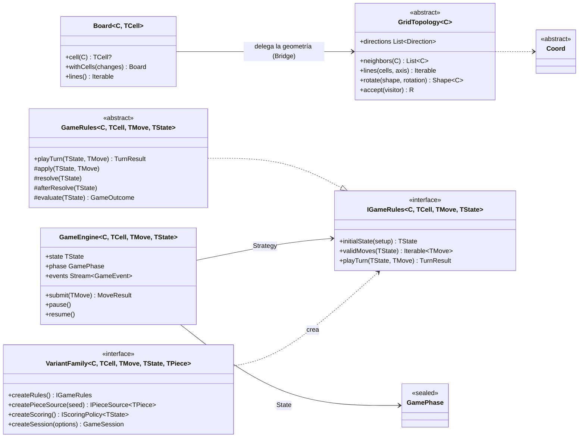
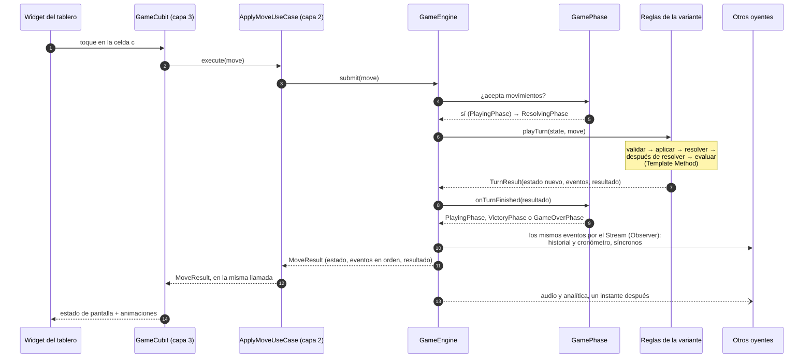

# ARQ-02 — Motor genérico (Paso 3)

| Campo | Valor |
|---|---|
| Estado | **Decidido (17-11-2026)**: el equipo adoptó todas las recomendaciones, con la mejora de D-32 (D-29 a D-35 en `docs/DECISIONES.md`). Sigue abierta D-36 (§9.6) |
| Fecha | 2026-11-17 (revisión: D-32 con retorno síncrono a la pantalla; decidido el mismo día) |
| Repositorio | `hexablock-app` (`docs/architecture/ARQ-02-MOTOR.md`) |
| Parte de | `ARQ-01-APP-GENERAL.md` §10: responde las 6 preguntas de partida del Paso 3 |
| Fija | Tipos genéricos, contratos del motor, ciclo de turno, fases de la partida, eventos, deshacer, capacidades opcionales y **patrones de diseño del dominio** |
| No fija | Firmas de los casos de uso y puertos (Paso 4), formato de los niveles (`docs/contracts/`, Paso 5) y del estado guardado (lo define el codec de cada variante, `ARQ-04-APP-DATOS.md` §8) |

**Cómo leer este documento.** Cada pregunta trae opciones con ventajas y desventajas, la **recomendación** y un esbozo de código. El equipo adoptó la opción recomendada en las 6 preguntas y en el mapa de patrones; las demás opciones quedan como registro de lo que se descartó y por qué, útil para la defensa.

> **Los esbozos de código no están compilados.** En esta planificación no hay SDK de Dart disponible. Están escritos para Dart 3 (*sealed*, *records*, *extension types*, genéricos reificados) y se validan en el *spike* de TEC-01 antes de escribir las variantes. El código va en inglés.

---

## 1. Qué tiene que cumplir el motor

| Exigencia | Fuente |
|---|---|
| Un solo tablero y un solo motor, genéricos en contenido de celda, movimiento y estado; las 4 variantes son instanciaciones, no copias | Enunciado §3.1, RNF-01 |
| La figura de la celda también es genérica: `Board<TCoord, TCell>` (hexágonos, cuadrados, triángulos, cubos) | D-07, D-18, D-25, RNF-04 |
| El motor no tiene condicionales por variante ni por figura | Enunciado §3.2 (LSP), RNF-02 |
| Ciclo fijo: validar → aplicar → resolver → evaluar → notificar; cada paso visible se notifica en orden | RN-COM-20 a 25 |
| Fases: en juego, resolviendo, en pausa, victoria, derrota; Merge sigue tras la victoria | RN-COM-30, 31; RN-HM-51 |
| Determinismo con semilla; el generador es parte del estado y se restaura al deshacer | RN-COM-40 a 45 |
| Deshacer: Lines no, Fit ilimitado + rehacer, Sort no, Merge 1 | RN-COM-60 a 63 |
| Tiempo activo en Fit (sin pausas) | RN-COM-52, RN-HF-52 |
| Restricciones de tipo justificadas (p. ej., `TCell: IMergeable<TCell>`) | Enunciado §3.1, RNF-05 |
| Strategy y Abstract Factory obligatorios; además, al menos 2 patrones por categoría | Enunciado §3.3, RNF-09 |
| El dominio no depende de nada externo y se prueba con un tipo de celda de prueba | Enunciado §3.4, §3.6; RNF-06 |
| Un cambio de regla en la defensa queda confinado a clases nuevas o a configuración | Enunciado §3.1 |

## 2. Vista general (con las recomendaciones aplicadas)





---

## 3. Pregunta 1 — Despacho de la figura y alcance de `TCoord` (D-29)

La figura la elige el jugador en Ajustes (D-25), así que se conoce **en tiempo de ejecución**, pero el tipo `TCoord` tiene que existir **en compilación** para que el tablero sea seguro (D-07). Hace falta un punto que convierta "el id `hex` que leí de Ajustes" en "`GameEngine<HexCoord, …>`", sin casts y sin condicionales fuera del *composition root*.

### 3.1 Cómo se despacha

| Opción | Cómo | Ventajas | Desventajas |
|---|---|---|---|
| **A. Registro de topologías + Visitor genérico** | Cada topología se registra con su id. `GridTopology<C>` tiene un método `accept(visitor)` que llama a `visitor.visit<C>(this)`: como Dart **reifica** los genéricos, el visitante recibe el `C` real | Sin `switch` en ningún lado; agregar una figura = crear la clase y registrarla (OCP). Cero casts. Es un patrón GoF (Visitor) que se puede mostrar en la defensa | Un concepto más que explicar (doble despacho con método genérico) |
| B. `switch` en el *composition root* | `switch (id) { 'hex' => open<HexCoord>(HexTopology()), 'square' => … }` | El más simple de leer | Agregar una figura modifica el `switch` (aunque esté en el *root*, que sí puede conocer lo concreto) |
| C. Borrar el tipo (`Board<Coord, TCell>` y casts) | Todo trabaja con `Coord` y las topologías castean | Sin genéricos que propagar | Contradice D-07: errores en ejecución en vez de en compilación |

**Recomendación: A.** El registro no pierde nada: una `GridTopology<HexCoord>` se guarda como `GridTopology<Coord>` (los genéricos de Dart son covariantes) y `accept` recupera el tipo real.

```dart
// hexa_engine
abstract interface class TopologyVisitor<R> {
  R visit<C extends Coord>(GridTopology<C> topology);
}

abstract base class GridTopology<C extends Coord> {
  String get id; // 'hex', 'square', 'tri', 'cube'
  // ... geometry operations (RN-COM-10) ...

  /// Double dispatch that keeps the real coordinate type.
  R accept<R>(TopologyVisitor<R> visitor) => visitor.visit<C>(this);
}
```

En el dominio, el Visitor lo usan las herramientas que trabajan con cualquier figura sin interfaz, como el validador de niveles del CI (D-19): lee `topology: hex` del JSON y valida el nivel con el `C` correcto. En la app, cada figura se registra **junto con su layout** (capa 4), y la entrada del registro usa el mismo truco. Así, el layout también llega tipado, sin un segundo registro que obligaría a castear:

```dart
// app/lib/config (composition root): no switch, no casts
final class TopologyEntry<C extends Coord> {
  const TopologyEntry(this.topology, this.layout);
  final GridTopology<C> topology;
  final TopologyLayout<C> layout; // where each cell is drawn, which cell was tapped
  R accept<R>(TopologyEntryVisitor<R> visitor) => visitor.visit<C>(this);
}

final class OpenGame implements TopologyEntryVisitor<Widget> {
  OpenGame(this.module, this.options);
  final VariantModule module; // registered by gameId
  final StartOptions options;

  @override
  Widget visit<C extends Coord>(TopologyEntry<C> entry) =>
      module.open<C>(entry, options); // typed end to end
}

final entry = topologyRegistry[settings.cellShape]!; // TopologyEntry<Coord>
final page = entry.accept(OpenGame(variantModules[gameId]!, options));
```

`VariantModule` vive en `app/lib/config/` (uno por variante). Conoce los tipos concretos de su variante y, ya con `C`, crea su fábrica de dominio, el `GameCubit` y el pintor de contenido:

```dart
final class HexaLinesModule implements VariantModule {
  @override
  Widget open<C extends Coord>(TopologyEntry<C> entry, StartOptions options) {
    final family = HexaLinesFactory<C>(entry.topology, config.linesFor(entry.topology.id));
    final session = family.createSession(options);
    return GamePage<C, PieceColor, LinesMove<C>, LinesState<C>>(
      cubit: GameCubit(applyMove: ApplyMoveUseCase(session), /* ... */),
      painter: const LinesCellPainter(),
      layout: entry.layout,
    );
  }
}
```

### 3.2 Hasta qué capa llega `TCoord`

| Opción | Hasta dónde | Ventajas | Desventajas |
|---|---|---|---|
| **A. Hasta el widget del tablero** | Dominio, casos de uso (`ApplyMoveUseCase<C, …>`), `GameCubit<C, …>` y el widget del tablero (`BoardView<C, TCell>` = layout de la topología × pintor de la variante, ARQ-A-06). El resto de la pantalla (marcador, botones) no es genérico | Seguridad de tipos completa: el toque se convierte en `C` en el layout y nunca hay un índice suelto | Los widgets del tablero son genéricos (en Flutter no es un problema) |
| B. Hasta el Cubit | El Cubit expone celdas por índice y posición; los widgets no son genéricos | Widgets más simples | Hace falta un mapeo índice ↔ `C` y el layout (que es por topología) igual necesita `C` |

**Recomendación: A.** El layout es por topología, así que ya conoce `C`; ocultarlo en el Cubit solo agrega una traducción.

---

## 4. Pregunta 2 — `TCell`, `TMove`, `TState` por variante y restricciones de tipo (D-30)

### 4.1 Tres decisiones de base

| Tema | Opciones | Recomendación |
|---|---|---|
| **Estado inmutable o mutable** | **A. Inmutable**: `playTurn` devuelve un estado nuevo; el tablero cambia con `withCells` (copia de un mapa de ≤ 64 celdas) · B. Mutable con copias explícitas al deshacer | **A.** Deshacer, rehacer, guardar y las pruebas salen gratis (un estado anterior *es* el memento); las reglas son funciones puras y deterministas (RN-COM-41). El costo de copiar 61 celdas por turno es despreciable |
| **Celda vacía** | **A. `TCell?`**: el tablero guarda solo celdas ocupadas y `cell(c)` devuelve `null` si está vacía · B. Un valor centinela por variante (`TCell.empty`) · C. Un tipo `Option<TCell>` | **A.** Es lo idiomático en Dart con *null safety*, y obliga a la restricción `TCell extends Object` (ver 4.3) |
| **Movimientos** | **A. Una jerarquía *sealed* por variante** (`sealed class FitMove`) · B. Un tipo de movimiento genérico con un `kind` | **A.** El `switch` sobre un tipo *sealed* es exhaustivo: el compilador avisa si una regla olvida un caso |

### 4.2 Instanciación por variante

| | Hexa Lines | Hexa Fit | Hexa Sort | Hexa Merge |
|---|---|---|---|---|
| **`TCell`** | `PieceColor` (solo visual, RN-HL-01) | `PieceId` (*extension type* sobre `int`, RN-HF-01) | `ColorStack` (lista inmutable de colores, de abajo arriba; bloque de cima, RN-HS-02) | `Tile` (valor potencia de 2) que implementa `Mergeable<Tile>` |
| **`TMove`** | `PlacePiece<C>(trayIndex, anchor)` | *sealed* `FitMove<C>`: `PlaceFitPiece`, `MoveFitPiece`, `RemoveFitPiece`, `RotateFitPiece` (este no cuenta como movimiento, RN-HF-61) | `PlaceStack<C>(cell)` | `Slide(direction)` |
| **`TState`** | Tablero, bandeja (≤ 3 piezas), fuente de piezas, puntaje, racha `k`, semilla | Tablero (= figura), bandeja con orientaciones, piezas colocadas, movimientos | Tablero, pila de la bandeja, fuente de pilas, metas cumplidas y objetivo, movimientos, puntaje, semilla | Tablero, puntaje, fuente de fichas, ficha objetivo, victoria ya anunciada, semilla |
| **`TPiece`** (de `IPieceSource`) | `LinesPiece<C>` (forma + color) | `FitPiece<C>` (id + forma) | `ColorStack` | `Tile` (la ficha nueva: 90 % de 2, 10 % de 4) |
| **Aplicar** | Ocupar las celdas | Colocar, mover, retirar o rotar | Poner la pila | Deslizar sin fusionar |
| **Resolver** | Vaciar las líneas completas de todos los ejes (un paso, RN-HL-43) | — (RN-HF-40) | Cascada con cola y desempate horario (RN-HS-42, 43) | Fusionar una vez por ficha desde el frente y compactar (RN-HM-41, 42) |
| **Después de resolver** | Bandeja nueva si quedó vacía (RN-HL-21) | — | Pila nueva en la bandeja (RN-HS-20) | Ficha nueva (RN-HM-20, 21) |
| **Evaluar** | Derrota si no hay movimientos válidos (*default*) | Victoria si la figura está cubierta; nunca derrota | Victoria si se cumplen las metas; si no, derrota sin movimientos válidos (*default*) | Victoria con ficha ≥ objetivo (puede seguir); derrota sin movimientos válidos (*default*) |

Tres de las cuatro variantes usan la misma condición de derrota, "no quedan movimientos válidos": Lines (ninguna pieza cabe), Sort (no hay celda vacía) y Merge (ningún deslizamiento cambia el tablero). Por eso esa condición va como comportamiento por defecto en la clase base (Template Method, §9).

En Merge, el enunciado sugiere `TCell = int`; se propone `Tile`, porque un `int` no puede implementar `Mergeable` (ni siquiera como *extension type*) y la restricción es justamente el ejemplo de §3.1.

### 4.3 Restricciones de tipo (para el README, RNF-05)

| Parámetro | Restricción | Por qué |
|---|---|---|
| `C` | `C extends Coord` | El tablero y la topología necesitan un valor con igualdad y `hashCode` para usarlo como clave; `Coord` lo exige a todas las coordenadas |
| `TCell` | `TCell extends Object` | Prohíbe tipos que acepten `null`, para que `TCell?` signifique sin ambigüedad "celda vacía" |
| `TState` | `TState extends GameState<C, TCell>` | El motor necesita leer el tablero y el puntaje de cualquier estado para notificar y guardar, sin conocer la variante |
| `TMove` | Sin restricción | El motor nunca lo inspecciona: solo lo pasa a las reglas. Una restricción vacía sería decorativa |
| `TPiece` | Sin restricción | Una pila de Sort no es una forma; la fuente de piezas solo entrega valores |
| `T` en `SlideMergeResolver<C, T>` | `T extends Mergeable<T>` (F-acotado) | El algoritmo de deslizar y fusionar solo necesita saber si dos valores se fusionan y en qué; con esta restricción sirve para cualquier contenido fusionable, no solo para potencias de 2 |

```dart
// hexa_engine
abstract base class Coord {
  const Coord(); // subclasses implement == and hashCode
}

abstract interface class GameState<C extends Coord, TCell extends Object> {
  Board<C, TCell> get board;
  int get score;
}

abstract interface class Mergeable<T extends Mergeable<T>> {
  bool canMergeWith(T other);
  T mergedWith(T other);
  int get mergePoints; // RN-HM-60: value of the produced tile
}

// hexa_variants/merge
final class Tile implements Mergeable<Tile> {
  const Tile(this.value);
  final int value;
  @override bool canMergeWith(Tile other) => other.value == value;
  @override Tile mergedWith(Tile other) => Tile(value * 2);
  @override int get mergePoints => value * 2;
  // == and hashCode by value
}

// hexa_variants/fit
extension type const PieceId(int value) {}
```

---

## 5. Pregunta 3 — Deshacer y rehacer (D-31)

| Opción | Cómo | Ventajas | Desventajas |
|---|---|---|---|
| A. Memento puro | Una pila de estados anteriores | Lo más simple con estado inmutable | No aparece el patrón Command que sugiere el enunciado §3.3 |
| B. Command con operación inversa | Cada movimiento sabe deshacerse | Usa poca memoria | La inversa de Merge (deslizar + fusionar + ficha nueva + generador) es difícil y propensa a errores; cada variante nueva tiene que escribir su inversa |
| **C. Command + Memento** | Cada turno aplicado queda como un objeto `MoveCommand` con el movimiento y los estados de antes y después; `undo()` y `redo()` los restauran. El historial es el invocador que guarda los comandos | Genérico para cualquier variante: ninguna escribe lógica inversa. Restaura todo, generador incluido (RN-COM-61, RN-HM-80). Cumple el Command del enunciado, y GoF mismo propone combinarlo con Memento para deshacer | Guarda dos estados por turno (unos pocos KB en Fit; en Merge el límite es 1) |
| D. Repetición desde la semilla | Deshacer = repetir desde el inicio los movimientos menos el último (RN-COM-41) | Mínima memoria; útil también para reproducir partidas | Cuesta O(n) por cada deshacer |

**Recomendación: C.** La lógica (historial, límite, rehacer descartado y fases que bloquean) se comprobó con un modelo en Python contra E-HF-3, E-HM-7 y RN-COM-21, 24 y 60 a 63: `tools/reference-sim/engine_model.py`.

La capacidad la da un único `UndoHistory` configurado por la fábrica de cada variante: sin límite y con rehacer para Fit, límite 1 sin rehacer para Merge, y nada para Lines y Sort. Las reglas que impiden deshacer (RN-COM-63) las decide la **fase**: `GameOverPhase` y `VictoryPhase` no permiten deshacer; en Merge, al seguir jugando se vuelve a `PlayingPhase`, que sí lo permite.

```dart
// hexa_engine
abstract interface class Restorable<TState> {
  void restore(TState snapshot); // emits StateRestored
}

/// What UndoHistory needs from GameEngine (ISP): GameEngine implements it.
abstract interface class UndoableEngine<TMove, TState> implements Restorable<TState> {
  GamePhase get phase;
  Stream<MoveCommand<TMove, TState>> get committedTurns; // one per valid turn
}

final class MoveCommand<TMove, TState> {
  const MoveCommand(this.move, this.before, this.after);
  final TMove move;
  final TState before, after; // mementos: immutable states

  void undo(Restorable<TState> engine) => engine.restore(before);
  void redo(Restorable<TState> engine) => engine.restore(after);
}

final class UndoHistory<TMove, TState> implements IUndoable {
  UndoHistory(this._engine, {this.limit, this.allowsRedo = false}) {
    _engine.committedTurns.listen(_record); // Observer, synchronous stream (D-32)
  }
  final UndoableEngine<TMove, TState> _engine;
  final int? limit; // null = unlimited (Fit); 1 = Hexa Merge
  final bool allowsRedo;
  final _done = <MoveCommand<TMove, TState>>[];
  final _undone = <MoveCommand<TMove, TState>>[];

  @override bool get canUndo => _done.isNotEmpty && _engine.phase.allowsUndo;
  @override bool get canRedo => allowsRedo && _undone.isNotEmpty && _engine.phase.allowsUndo;

  @override
  void undo() {
    if (!canUndo) return;
    final command = _done.removeLast()..undo(_engine);
    if (allowsRedo) _undone.add(command);
  }

  @override
  void redo() {
    if (!canRedo) return;
    _done.add(_undone.removeLast()..redo(_engine));
  }

  void _record(MoveCommand<TMove, TState> command) {
    _undone.clear(); // RN-COM-62
    _done.add(command);
    if (limit != null && _done.length > limit!) _done.removeAt(0);
  }
}
```

---

## 6. Pregunta 4 — Eventos de dominio (D-32)

| Opción | Cómo | Ventajas | Desventajas |
|---|---|---|---|
| A. Eventos como datos + `Stream` del motor | Las reglas devuelven los eventos del turno en orden dentro del `TurnResult`; el motor los publica en un `Stream<GameEvent<C>>` (Observer). Jerarquía abierta: una base `GameEvent<C>`, los eventos del motor (`PhaseChanged`, `ScoreChanged`, `MoveRejected`, `StateRestored`) y una familia *sealed* por variante (`LinesCleared`, `StackTransferred`, `GoalCompleted`, `TilesMerged`, `TileSpawned`…) | Las reglas siguen puras (se prueban comparando listas de eventos); el orden de la cascada se conserva (RN-COM-25, RN-HS-45); cada variante hace `switch` exhaustivo sobre sus eventos | Hay que definir una clase por evento |
| **A2. Como A, pero la pantalla los recibe como valor de retorno** | Los mismos eventos que A. `submit` **devuelve** un `MoveResult` con el estado nuevo, los eventos en orden y el resultado; el caso de uso se lo pasa al Cubit en la misma llamada. El `Stream` queda para los oyentes secundarios: historial de deshacer, cronómetro, audio y analítica | Todo lo de A, y además la pantalla no depende del momento en que el `Stream` entrega los eventos: recibe todo antes del siguiente cuadro. Las pruebas comparan lo que devuelve `submit` | Dos caminos que documentar (retorno y `Stream`) |
| B. Solo estados | La interfaz compara el estado anterior con el nuevo | Nada que definir | Pierde el orden y los pasos intermedios de la cascada: no se puede animar Sort |
| C. Llamadas a oyentes desde las reglas | Las reglas reciben un `listener` y lo llaman | Inmediato | Reglas con efectos secundarios: más difíciles de probar y de reutilizar |
| D. Bus de eventos global | Un singleton al que todos publican | Desacopla mucho | Dependencias ocultas; difícil de seguir en una defensa |

**Recomendación: A2.** El turno se calcula completo, en menos de un milisegundo, y después:

1. **La pantalla** recibe el `MoveResult` como valor de retorno de `submit` → `ApplyMoveUseCase` → `GameCubit`. El retraso que ve el jugador es solo el de las animaciones, y lo controla la vista: su duración, la opción de saltarlas y el bloqueo de toques mientras se reproducen.
2. **Los oyentes internos del dominio** (`UndoHistory` y `ActiveTimer`) se suscriben a un `StreamController.broadcast(sync: true)`: reciben cada evento antes de que `submit` termine, así que el historial y el cronómetro ya están al día cuando la pantalla se redibuja. Ninguno de ellos llama a `submit`, lo que evita la reentrada que permite un *stream* síncrono.
3. **Los oyentes externos** (el audio y la analítica, ARQ-A-07) se suscriben al `Stream` normal, que entrega los eventos en un instante posterior. No son urgentes.

El tipo de retorno no se llama igual que los eventos para que no se confundan: `MoveRejected` es un evento (por ejemplo, para el sonido de error); `RejectedMove` es el resultado que devuelve `submit`.

```dart
// hexa_engine
sealed class MoveResult<C extends Coord, TState> { const MoveResult(); }

final class AcceptedMove<C extends Coord, TState> extends MoveResult<C, TState> {
  const AcceptedMove(this.state, this.events, this.outcome);
  final TState state;
  final List<GameEvent<C>> events; // in order: what the screen animates
  final GameOutcome outcome;
}

final class RejectedMove<C extends Coord, TState> extends MoveResult<C, TState> {
  const RejectedMove(this.reason); // RN-COM-21: state unchanged
  final String reason;
}

abstract base class GameEvent<C extends Coord> { const GameEvent(); }

final class PhaseChanged<C extends Coord> extends GameEvent<C> {
  const PhaseChanged(this.from, this.to);
  final GamePhase from, to;
}

// hexa_variants/lines
sealed class LinesEvent<C extends Coord> extends GameEvent<C> { const LinesEvent(); }

final class LinesCleared<C extends Coord> extends LinesEvent<C> {
  const LinesCleared(this.lines, this.clearedCells);
  final List<List<C>> lines;  // each line counts for scoring (RN-HL-42)
  final Set<C> clearedCells;  // each cell is emptied once
}
```

Una base *sealed* común no sirve: Dart solo permite extender una clase *sealed* desde su propia biblioteca, y las variantes viven en otro paquete. Por eso la base es `abstract base` y cada variante define su propia familia *sealed*.

---

## 7. Pregunta 5 — Capacidades opcionales (D-33)

El enunciado §3.2 (ISP) pide separar `IUndoable`, `ITimed` e `IRandomSeeded`, y que Hexa Lines no implemente `IUndoable`.

| Opción | Cómo | Ventajas | Desventajas |
|---|---|---|---|
| **A. Interfaces segregadas implementadas por componentes que compone la fábrica** | `IUndoable` → `UndoHistory`; `ITimed` → `ActiveTimer`; `IRandomSeeded` → los estados que usan azar; `ILevelBased` → los estados de Fit y Sort. La fábrica de cada variante arma una `GameSession` con el motor y **solo** las capacidades que tiene (las demás quedan en `null`) | ISP literal: Lines no tiene ningún objeto `IUndoable`. El motor queda chico. La interfaz muestra el botón de deshacer si `session.undo != null`, sin preguntar por la variante | Una sesión con campos opcionales |
| B. Decoradores del motor | `UndoableEngine(TimedEngine(engine))` | Patrón visible | Al apilar decoradores, el de afuera oculta las interfaces de los de adentro: hacen falta casts o la misma sesión de A |
| C. Interfaces implementadas por las reglas | `HexaFitRules implements IUndoable, ITimed` | Directo | Las reglas dejan de ser puras: guardarían historial y reloj |
| D. Banderas en la configuración | Un motor con todas las capacidades y `if (config.undo)` | Una sola clase | Va contra ISP y SRP, que es justo lo que se evalúa |

**Recomendación: A.** El tiempo activo necesita un reloj: se propone un puerto mínimo **en el dominio**, `IMonotonicClock` (milisegundos monótonos), porque las estrellas de Fit dependen del tiempo (RN-HF-62). El `IClock` de la capa 2 (ARQ-01-APP §4.2) lo extiende, y la misma implementación de la capa 4 sirve para los dos. `ActiveTimer` escucha `PhaseChanged`: corre en juego y resolviendo, y se detiene en pausa, victoria y derrota (RN-COM-52).

```dart
// hexa_engine
abstract interface class IUndoable { bool get canUndo; bool get canRedo; void undo(); void redo(); }
abstract interface class ITimed { Duration get activeTime; }
abstract interface class IRandomSeeded { int get seed; }

final class GameSession<C extends Coord, TCell extends Object, TMove,
    TState extends GameState<C, TCell>> {
  const GameSession(this.engine, {this.undo, this.timer});
  final GameEngine<C, TCell, TMove, TState> engine;
  final IUndoable? undo; // Fit and Merge only
  final ITimed? timer;   // Fit only
}
```

| Capacidad | Lines | Fit | Sort | Merge |
|---|---|---|---|---|
| `IUndoable` | — | ilimitado + rehacer | — | 1, sin rehacer |
| `ITimed` | — | ✓ | — | — |
| `IRandomSeeded` | ✓ | — | ✓ | ✓ |
| `ILevelBased` | — | ✓ | ✓ | — |

---

## 8. Pregunta 6 — Fases de la partida (D-34)

Para no confundir el `TState` (los **datos** de la partida) con el patrón State, se propone llamar **fase** a la etapa del ciclo de vida. Las clases equivalen a las del enunciado §3.3: `PlayingPhase` = `PlayingState`, y así con las demás. `MenuState` no es una fase de la partida (RN-COM-30): el menú es navegación.

| Opción | Cómo | Ventajas | Desventajas |
|---|---|---|---|
| **A. Patrón State con una jerarquía *sealed*** | Cada fase es una clase que decide qué acepta y a qué fase pasa (`PlayingPhase`, `ResolvingPhase`, `PausedPhase`, `VictoryPhase`, `GameOverPhase`); el motor delega en la fase actual | Es el patrón que pide el enunciado; las transiciones inválidas no existen porque cada fase solo expone las suyas; la interfaz hace `switch` exhaustivo para elegir la pantalla | Cinco clases pequeñas |
| B. `enum` + tabla de transiciones | `Map<(Phase, Trigger), Phase>` | Compacto | La lógica de cada fase queda repartida en `if` dentro del motor |
| C. `enum` + `switch` en el motor | Un `switch` por operación | El más directo | Crece con cada operación; no muestra el patrón |

**Recomendación: A.** `VictoryPhase` lleva `canContinue`, que viene del resultado de la evaluación. Solo Merge devuelve `Victory(canContinue: true)`, y solo la primera vez (RN-HM-51), así que el motor no sabe qué variante permite seguir.

```dart
// hexa_engine
sealed class GamePhase {
  const GamePhase();
  bool get acceptsMoves => false;
  bool get allowsUndo => false;
  GamePhase onPause() => this;
  GamePhase onResume() => this;
  GamePhase onContinue() => this;
}

final class PlayingPhase extends GamePhase {
  const PlayingPhase();
  @override bool get acceptsMoves => true;
  @override bool get allowsUndo => true;
  @override GamePhase onPause() => const PausedPhase();
  GamePhase onTurnStarted() => const ResolvingPhase();
}

final class ResolvingPhase extends GamePhase {
  const ResolvingPhase();
  GamePhase onTurnFinished(GameOutcome outcome) => switch (outcome) {
        Ongoing() => const PlayingPhase(),
        Victory(:final canContinue) => VictoryPhase(canContinue: canContinue),
        Defeat() => const GameOverPhase(),
      };
}

final class PausedPhase extends GamePhase {
  const PausedPhase();
  @override GamePhase onResume() => const PlayingPhase();
}

final class VictoryPhase extends GamePhase {
  const VictoryPhase({required this.canContinue});
  final bool canContinue;
  @override GamePhase onContinue() => canContinue ? const PlayingPhase() : this;
}

final class GameOverPhase extends GamePhase { const GameOverPhase(); }

sealed class GameOutcome { const GameOutcome(); }
final class Ongoing extends GameOutcome { const Ongoing(); }
final class Victory extends GameOutcome { const Victory({this.canContinue = false}); final bool canContinue; }
final class Defeat extends GameOutcome { const Defeat(); }
```

**La resolución es síncrona.** El motor pasa por `ResolvingPhase` mientras calcula el turno y la publica en los eventos (`PhaseChanged`). Con eso cumple RN-COM-24: un `submit` que llegue durante un turno se rechaza. La animación posterior la controla la vista.

---

## 9. Patrones de diseño en el dominio (D-35)

El dominio son los paquetes `hexa_engine`, `hexa_topologies` y `hexa_variants` (capa 1). La propuesta pone **14 patrones** en el dominio: 3 creacionales, 3 estructurales y 8 de comportamiento. Eso supera lo que pide RNF-09 (al menos 2 por categoría, más Strategy y Abstract Factory). Cada uno resuelve un problema real del motor; ninguno está solo para cumplir.

### 9.1 Creacionales

| Patrón | Dónde | Qué problema resuelve | Enunciado |
|---|---|---|---|
| **Abstract Factory** (obligatorio) | `VariantFamily<C, TCell, TMove, TState, TPiece>`, con `HexaLinesFactory<C>`, `HexaFitFactory<C>`, `HexaSortFactory<C>` y `HexaMergeFactory<C>` | Crea la familia coherente de cada variante: reglas, fuente de piezas, política de puntuación, forma del tablero y la sesión con sus capacidades. Como es genérica en `C`, la misma fábrica sirve para cualquier figura | §3.3 (el ejemplo es el mismo) |
| **Builder** | `FitLevelBuilder<C>` y `SortLevelBuilder<C>` en `hexa_variants` | Arma un nivel paso a paso (figura, piezas, metas, umbrales) y lo **valida** al final (RN-HF-12, D-19). El *mapper* de JSON (capa 3) actúa como director; el validador de niveles del CI usa el mismo builder | §3.3 |
| **Factory Method** | `GridTopology<C>.cellsOf(ShapeSpec)`: cada topología decide cómo crear las celdas de una forma de tablero (hexágono de radio R, rectángulo N × M, hexágono de triángulos de lado n, caja de cubos) | `Board` se crea sin conocer la figura: la topología concreta fabrica sus coordenadas a partir de la configuración (RNF-11) | — |

### 9.2 Estructurales

| Patrón | Dónde | Qué problema resuelve | Enunciado |
|---|---|---|---|
| **Bridge** | `Board<C, TCell>` (abstracción) ↔ `GridTopology<C>` (implementador) | Separa **qué hay en las celdas** (varía por variante) de **cómo es la rejilla** (varía por figura): 4 variantes × 4 figuras sin 16 clases de tablero. Es el núcleo de D-07 | — |
| **Composite** | `Shape<C>`: `CellShape` (hoja) y `CompositeShape` (compuesto). Las piezas son composiciones de celdas y las figuras de Fit, composiciones de regiones (por ejemplo, un hexágono más una línea) | Rotar, trasladar y normalizar tratan igual una celda, una pieza o una figura entera. Además, los niveles se diseñan a mano más rápido componiendo regiones | §3.3 (el ejemplo es el mismo) |
| **Decorator** | Sobre `IScoringPolicy<TState>`: `StreakMultiplier` envuelve el bono de líneas de Lines (RN-HL-63); `BonusMultiplierDecorator<TState>` sirve para cualquier variante. Sobre `IGameRules`: decoradores de regla como `MoveLimitRulesDecorator` | Agrega comportamiento sin tocar la clase base: es la vía para el **cambio de regla en vivo** de la defensa | §3.3 (`BonusMultiplierDecorator`, `TimedRulesDecorator`) |

### 9.3 De comportamiento

| Patrón | Dónde | Qué problema resuelve | Enunciado |
|---|---|---|---|
| **Strategy** (obligatorio) | `IGameRules` (el motor la usa sin saber cuál es), `IScoringPolicy<TState>`, `IPieceSource<TPiece>` (`WeightedRandomPieceSource`, `FixedPieceSource`, `RandomStackSource`, `RandomTileSource`) e `IProgressModel` (récord o niveles con estrellas) | Todo lo que varía entre variantes se intercambia sin tocar el motor | §3.3 ("patrón central") |
| **Template Method** | `GameRules<…>` (abstracta): `playTurn` fija el orden validar → aplicar → resolver → después de resolver → evaluar. Los pasos son *hooks*: `resolve` y `afterResolve` no hacen nada por defecto (Fit) y `evaluate`, por defecto, es "derrota si no hay movimientos válidos" (Lines, Sort y Merge) | Ninguna variante puede saltarse ni reordenar pasos (RN-COM-20, 23) | §3.3 (el ejemplo es el mismo) |
| **State** | `GamePhase` y sus 5 fases (§8) | Ciclo de vida sin `if` repartidos | §3.3 |
| **Observer** | `GameEngine.events` (`Stream<GameEvent<C>>`); se suscriben `UndoHistory` y `ActiveTimer` (síncronos), y el audio y la analítica. La pantalla no se suscribe: recibe el `MoveResult` como retorno de `submit` (D-32) | Notifica cada paso en orden sin que el motor conozca a sus oyentes | §3.3 |
| **Command** | `MoveCommand<TMove, TState>` con `undo` y `redo`; `UndoHistory` es el invocador | Historial de deshacer y rehacer genérico | §3.3 |
| **Memento** | Los estados inmutables son los mementos; el motor es el originador (`restore`) y `UndoHistory`, el cuidador | Restaurar **todo**, generador incluido, sin lógica inversa (RN-COM-61) | — |
| **Iterator** | `GridTopology`: `lines`, `ray`, `neighbors` y `ring` devuelven `Iterable` perezosos (`sync*`); `validMoves` también es perezoso | Recorrer por ejes, anillos o vecindad sin exponer el mapa interno. Como es perezoso, "¿hay algún movimiento válido?" se detiene en el primero (fin de Lines, RN-HL-50) | §3.3 |
| **Visitor** | `TopologyVisitor<R>` + `GridTopology.accept` (§3.1); la app aplica lo mismo a su `TopologyEntry` | Despachar la figura elegida en ejecución conservando el tipo `C`, sin `switch` | — |

### 9.4 Patrones fuera del dominio (para el mapa completo del README)

| Patrón | Capa | Dónde |
|---|---|---|
| Decorator (AOP) | 2 | Aspectos sobre los casos de uso genéricos: logging (TEC-03), métricas, sesión (ARQ-A-05) |
| Adapter | 3 | Repositorios y gateways que implementan los puertos sobre Drift y dio |
| Facade | 4 | `AudioFacade` (ARQ-A-07) |
| Singleton (por inyección) | 4 | `get_it` con `registerLazySingleton` en el *composition root* |

### 9.5 Considerados y descartados en el dominio

| Patrón | Motivo |
|---|---|
| Prototype | Con estado inmutable no hace falta clonar: rotar o simular devuelve un objeto nuevo. Si el equipo prefiere estado mutable (D-30 B), Prototype pasa a ser necesario para deshacer y previsualizar |
| Singleton | En el dominio haría estado global y rompería el determinismo de las pruebas |
| Chain of Responsibility | La resolución de cada variante es un solo algoritmo; encadenar manejadores no simplifica nada |
| Flyweight | Las piezas y coordenadas ya son inmutables y livianas; no hay un problema de memoria que resolver |

### 9.6 Esbozo: Template Method de las reglas

```dart
// hexa_engine
abstract base class GameRules<C extends Coord, TCell extends Object, TMove,
    TState extends GameState<C, TCell>> implements IGameRules<C, TCell, TMove, TState> {
  /// Template method: fixed turn skeleton (RN-COM-20). Do not override.
  @override
  TurnResult<C, TState> playTurn(TState state, TMove move) {
    if (!isValid(state, move)) return RejectedTurn(state, reason: 'invalid move');
    final applied = apply(state, move);
    final resolved = resolve(applied.state);
    final settled = afterResolve(resolved.state);
    return PlayedTurn(
      settled.state,
      events: [...applied.events, ...resolved.events, ...settled.events],
      outcome: evaluate(settled.state), // after resolution (RN-COM-23)
    );
  }

  // Primitive operations
  bool isValid(TState state, TMove move);
  Step<C, TState> apply(TState state, TMove move);

  // Hooks with defaults
  Step<C, TState> resolve(TState state) => Step(state);      // Fit: no resolution
  Step<C, TState> afterResolve(TState state) => Step(state); // refill, spawn, next stack
  GameOutcome evaluate(TState state) =>
      validMoves(state).isEmpty ? const Defeat() : const Ongoing(); // lazy: stops at first
}

// hexa_variants/sort: victory first, then the default defeat check (RN-COM-23, RN-HS-54)
@override
GameOutcome evaluate(SortState<C> state) =>
    state.goalsDone >= state.goalsTarget ? const Victory() : super.evaluate(state);
```

`TurnResult` es *sealed*: `PlayedTurn` (estado nuevo, eventos y resultado) o `RejectedTurn` (el mismo estado y el motivo, RN-COM-21). Cada `Step` es un estado más los eventos de ese paso.

Dart no tiene métodos `final`. Para impedir que una variante sobrescriba `playTurn` hay dos caminos: la anotación `@nonVirtual` de `package:meta`, que es del equipo de Dart pero es una dependencia externa (ARQ-01-APP §3 dice "sin dependencias de terceros"), o una regla de revisión más una prueba de arquitectura. Está abierto en **D-36** (`PENDIENTES.md` §1.1). La recomendación es la **regla + prueba de arquitectura**, porque el enunciado §3.4 pide que la capa 1 no tenga ninguna dependencia externa.

---

## 10. Cómo responde el diseño a la defensa

| Lo que puede pedir el jurado | Dónde se implementa | Motor |
|---|---|---|
| Otro tamaño de tablero | Configuración (`assets/config/<gameId>.json`) → `GridTopology.cellsOf` | Sin cambios |
| Otra política de puntuación | Una clase `IScoringPolicy` nueva o un decorador, conectado en la fábrica de la variante | Sin cambios |
| Una forma de pieza nueva | El catálogo en configuración (Lines) o el nivel (Fit) | Sin cambios |
| Un cambio de regla (p. ej., límite de movimientos) | Un decorador de `IGameRules` en la fábrica | Sin cambios |
| Una 5ª variante | Una carpeta en `hexa_variants` (`VariantFamily` + reglas + eventos) y su `VariantModule` registrado en `app/lib/config/` | Sin cambios |
| Otra figura de celda | Una `GridTopology` nueva en `hexa_topologies`, su layout y su registro | Sin cambios |

## 11. Riesgos y cómo se verifican

| Riesgo | Verificación |
|---|---|
| Los esbozos no compilan tal cual (sin SDK en la planificación) | *Spike* de TEC-01: compilar `hexa_engine` con un tipo de celda de prueba y una topología de prueba antes de empezar Hexa Merge |
| La covarianza de Dart permite pasar una `HexCoord` a una topología de cuadrados guardada como `GridTopology<Coord>` (error en ejecución) | Del registro solo se llama a `accept`; toda operación geométrica ocurre ya dentro del visitante, con `C` concreto. Una prueba lo comprueba |
| Copiar el estado en cada turno es lento | El tablero más grande tiene 64 celdas; se mide con el aspecto de métricas (ARQ-A-05) en la cascada de Sort y en la búsqueda de movimientos de Lines |
| En Merge, deshacer la jugada que ganó y repetirla vuelve a anunciar la victoria, porque el estado restaurado no la tenía anunciada | Es coherente con "deshacer restaura todo" (RN-COM-61). Si el equipo prefiere no repetir el anuncio, se agrega una regla a `02-RN-HEXA-MERGE.md` |
| Demasiados patrones para explicar en la defensa | Cada uno tiene su fila en §9 con el problema que resuelve; los ensayos F-09 y F-10 recorren esta tabla |

## 12. Decisiones de este documento

| ID | Pregunta | Recomendación | Estado |
|---|---|---|---|
| D-29 | Despacho de la figura y alcance de `TCoord` | Registro de topologías + Visitor genérico; `TCoord` llega hasta el widget del tablero | ✅ Decidida (17-11) |
| D-30 | `TCell`, `TMove`, `TState` y restricciones | Estado inmutable, celda vacía = `null` (`TCell extends Object`), movimientos *sealed* por variante, `Tile implements Mergeable<Tile>` en Merge; tabla de §4 | ✅ Decidida (17-11) |
| D-31 | Deshacer y rehacer | Command + Memento con un `UndoHistory` genérico configurado por la fábrica | ✅ Decidida (17-11) |
| D-32 | Eventos de dominio | Eventos como datos devueltos por las reglas. La pantalla los recibe como valor de retorno de `submit` (`MoveResult`); el `Stream` del motor queda para el historial y el cronómetro (síncronos) y para el audio y la analítica; base `abstract base` y una familia *sealed* por variante | ✅ Decidida (17-11) |
| D-33 | Capacidades opcionales | Interfaces segregadas implementadas por componentes que compone la fábrica en una `GameSession`; `IMonotonicClock` en el dominio | ✅ Decidida (17-11) |
| D-34 | Fases de la partida | Patrón State con una jerarquía *sealed* de 5 fases; `Victory(canContinue)` para Merge | ✅ Decidida (17-11) |
| D-35 | Patrones de diseño del dominio | Los 14 de §9 (3 + 3 + 8). Cómo se protege el Template Method pasó a D-36 | ✅ Decidida (17-11) |
| D-36 | Protección del Template Method | Regla en la plantilla de PR + prueba de arquitectura en CI (sin dependencias, por el enunciado §3.4) | 🟡 Abierta |
