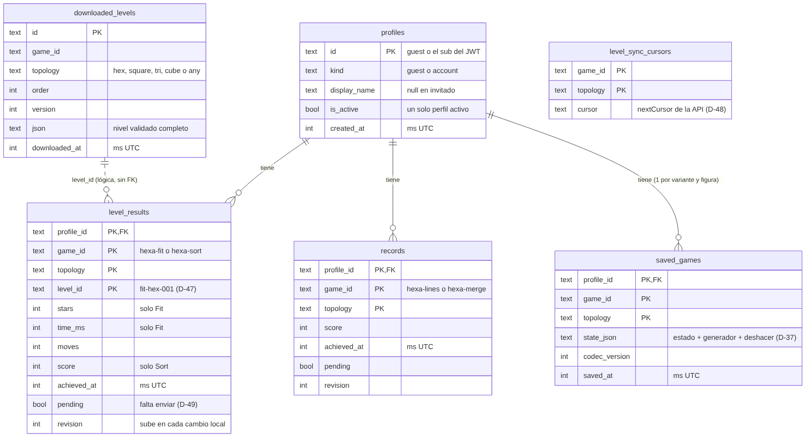

# ARQ-04 — Modelo de datos local de la app (Paso 5)

| Campo | Valor |
|---|---|
| Estado | Borrador para revisión del equipo, basado en D-27, D-37, D-45, D-47 a D-49 |
| Fecha | 2026-11-19 |
| Repositorio | `hexablock-app` (`docs/architecture/ARQ-04-APP-DATOS.md`) |
| Parte de | `ARQ-01-APP-GENERAL.md` §4 (persistencia) y `ARQ-03-APP-DETALLE.md` (puertos) |
| Contrato | `docs/contracts/` (copia idéntica de la del repo de la API, D-23) |
| Diagrama | `docs/diagrams/datos.mmd` → `datos.png` |

## 1. Dónde se guarda cada cosa

| Dato | Dónde | Por qué |
|---|---|---|
| Perfiles, resultados, récords, partidas guardadas, niveles descargados y cursores | **Drift** (SQLite) | Consultas por clave, transacciones y migraciones probadas (ADR-001 §2.1) |
| Ajustes (figura, idioma, sonido) | `shared_preferences` | Pocos valores sueltos |
| JWT | `flutter_secure_storage` (Keystore de Android) | Es una credencial (SEC-MOB-01); nunca va a SQLite ni a los registros |
| Niveles incluidos | `assets/levels/<gameId>/<id>.json` | Viajan dentro del APK; el CI los valida con `level.schema.json` y el validador del dominio |

## 2. Tablas



| Tabla | Clave | Contenido |
|---|---|---|
| `profiles` | `id` | `guest` (siempre existe) o el `sub` del JWT de una cuenta. Hay un solo perfil activo (RN-COM-81, 88, 89) |
| `level_results` | perfil, `gameId`, figura, nivel | El mejor intento de cada nivel completado de Fit y Sort (D-45, D-49). Si un nivel está en la tabla, está completado |
| `records` | perfil, `gameId`, figura | El récord de Lines y Merge |
| `saved_games` | perfil, `gameId`, figura | La partida en curso o en pausa (D-37). `codec_version` permite leer partidas guardadas por una versión anterior del APK |
| `downloaded_levels` | `id` | Niveles bajados de la API, ya validados (RN-COM-71, 76) |
| `level_sync_cursors` | `gameId`, figura | El `nextCursor` de la última descarga (D-48, RN-COM-77) |

Todas las fechas se guardan como milisegundos UTC (`int`) y se convierten a ISO 8601 al hablar con la API (D-46).

**Bosquejo en Drift** (una tabla; las demás siguen el mismo estilo):

```dart
class LevelResults extends Table {
  TextColumn get profileId => text().references(Profiles, #id, onDelete: KeyAction.cascade)();
  TextColumn get gameId => text()();
  TextColumn get topology => text()();
  TextColumn get levelId => text()();
  IntColumn get stars => integer().nullable()();   // Fit only
  IntColumn get timeMs => integer().nullable()();  // Fit only
  IntColumn get moves => integer()();
  IntColumn get score => integer().nullable()();   // Sort only
  IntColumn get achievedAt => integer()();          // ms UTC
  BoolColumn get pending => boolean().withDefault(const Constant(true))();
  IntColumn get revision => integer().withDefault(const Constant(0))();

  @override
  Set<Column> get primaryKey => {profileId, gameId, topology, levelId};
}
```

## 3. Guardar un resultado (`SaveProgressUseCase`)

En **una transacción**:
1. Se lee la fila del nivel (o del récord) del perfil activo.
2. Se consolida con el resultado nuevo usando el **mismo criterio que el servidor** (RN-COM-83; empate por `achievedAt` más antiguo).
3. Si el resultado mejoró, se escribe la fila con `pending = true` y `revision + 1`. Si no mejoró, no se toca nada y no hay nada que enviar.
4. Se borra la partida guardada de esa variante y figura (RN-COM-35).

## 4. Sincronizar (`SyncProgressUseCase`, RN-COM-86, D-49)

1. Por cada `gameId` con filas `pending`, se arma el cuerpo de `PUT /v1/me/progress/{gameId}`. Las filas se agrupan por figura, con la forma de `progressUpdate`: el mapa `levels` lleva **solo** los niveles pendientes.
2. Con la respuesta se consolida cada fila con lo que devolvió el servidor.
3. Se quita la marca `pending` **solo si `revision` no cambió desde que se armó el envío**. Si el jugador mejoró el nivel mientras la petición viajaba, la fila sigue pendiente y sale en la próxima sincronización. Así nunca se pierde un cambio.
4. Si la petición falla (sin red, 429, 5xx), las filas siguen pendientes. Reintentar es seguro (RN-COM-84).
5. Si la respuesta es 401, se borra el JWT y se pide iniciar sesión; las filas pendientes no se tocan (RN-COM-87).

**Al iniciar sesión en un dispositivo nuevo** (RN-COM-90): `GET /v1/me/progress` → se consolida con las filas del perfil de la cuenta, sin marcarlas como pendientes. **Importar el progreso de invitado** (RN-COM-88): se consolidan las filas de `guest` en las de la cuenta y quedan pendientes.

## 5. Niveles disponibles

La lista de una variante y figura es la **unión** de los niveles incluidos y de `downloaded_levels`. Para Sort, también entran los de figura `any`. Si un `id` está en los dos lados, gana el de mayor `version` (RN-COM-72). La lista se ordena por `order`. El desbloqueo se calcula con `level_results`: el nivel 1 siempre está disponible y cada nivel completado desbloquea el siguiente (RN-COM-73).

**Descarga** (`DownloadLevelsUseCase`):
1. Pide `GET /v1/levels` con el cursor guardado, página por página.
2. Valida cada nivel con el esquema y con el validador del dominio. Si un nivel falla, se descarta y se registra (RN-COM-71, 76).
3. Guarda los válidos y el `nextCursor` en una sola transacción, así una descarga cortada se retoma sin huecos.

## 6. Migraciones

Una actualización del APK no puede perder el progreso. Cada cambio de tablas:
- sube el `schemaVersion` de Drift;
- trae su paso de migración;
- trae una prueba que migra una base de la versión anterior (con los volcados de esquema de Drift).

La versión 1 es la de este documento. Su volcado está en `app/drift_schemas/drift_schema_v1.json` (PRG-03); cada versión nueva agrega el suyo con `dart run drift_dev schema dump lib/frameworks/persistence/app_database.dart drift_schemas/`, desde `app/`. El CI regenera el código de Drift y falla si `app_database.g.dart` no coincide con las tablas (#149), así un cambio de tablas no pasa sin regenerar.

## 7. Seguridad

| Riesgo | Medida |
|---|---|
| Robo del token | Solo en `flutter_secure_storage`; nunca en SQLite, en `shared_preferences` ni en los registros (SEC-MOB-01, SEC-WEB-06) |
| Copia de seguridad del teléfono | **Propuesta** (no está en SECURITY-BASELINE): dejar que Android respalde la base Drift, que no tiene secretos, para que un invitado recupere su progreso al cambiar de teléfono; y **excluir** del respaldo el archivo de `flutter_secure_storage` con reglas de respaldo, porque el token cifrado no se puede descifrar en otro teléfono. Se confirma al implementar |
| Niveles manipulados | Un nivel descargado solo se guarda si pasa todas las validaciones (SEC-MOB-06) |
| Progreso editado a mano en un teléfono con *root* | No se puede evitar en el cliente; el servidor rechaza lo no plausible (RN-COM-108) |

## 8. Formato de la partida guardada

`saved_games.state_json` no es parte del contrato con la API: nunca sale del teléfono. Lo escribe y lo lee el `IGameStateCodec<TState>` de cada variante (ARQ-03-APP, puertos). Reglas:
- guarda el estado completo, el estado del generador (RN-COM-42), el historial de deshacer y el tiempo activo (D-37). El historial es un `UndoSnapshot`: los estados a los que se puede deshacer y rehacer, escritos con el mismo codec del estado, sin movimientos (D-107). El estado actual no se repite en él; la escritura va en la cola del repositorio, fuera del turno. Lo que se escribe es el `SavedGame<TState>` de `GameSession.snapshot()` (D-113), y el codec de una variante con cronómetro siempre escribe su tiempo activo, porque continuar sin él le daría a Fit un tiempo de cero (RN-HF-62);
- `codec_version` sube cuando cambia el formato. Si una versión nueva del APK no puede leer una partida vieja, la descarta con un aviso; el progreso no se toca, porque vive en otras tablas;
- cada codec tiene una prueba de ida y vuelta: guardar, leer y comparar que el estado sea idéntico, incluida la siguiente pieza que sale del generador.

